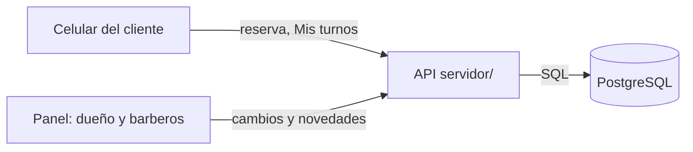

# API de Tommy Barber

La API (carpeta `servidor/`) conecta la página y el panel con la base de datos PostgreSQL. Está hecha con Node.js 22 y Express, y se publicó en Render; la base de datos está en Aiven.

- La página de los clientes pide los servicios, los barberos, los cambios de horario, las fotos y los horarios ocupados (sin datos de nadie), y reserva, cambia y cancela turnos.
- El panel se abre en **/acceso-barberos** con usuario y contraseña. El dueño ve todo; cada barbero ve solo Atender, Hoy y Turnos, con sus propios turnos y cobros.
- El servidor revisa todo de nuevo: que el horario esté libre (con las mismas reglas de la página), los topes contra turnos falsos, los números bloqueados y lo que puede hacer cada usuario.

## Contenido

- [Cómo funciona](#cómo-funciona)
- [Velocidad](#velocidad)
- [Seguridad](#seguridad)
- [Direcciones](#direcciones)
- [Variables de entorno](#variables-de-entorno)
- [Cómo correrla en la computadora](#cómo-correrla-en-la-computadora)
- [Pruebas](#pruebas)

## Cómo funciona



**Archivos de `servidor/`**

| Archivo | Qué hace |
|---|---|
| `index.js` | Arranque: aplica lo que falte de `base-de-datos/`, crea la cuenta del dueño si no hay y empieza a atender |
| `app.js` | Arma la aplicación: seguridad de las respuestas, quién puede usar la API desde el navegador, errores |
| `db.js` | Conexión a la base (cifrada) |
| `migraciones.js` | Aplica los archivos `base-de-datos/NN-*.sql` en orden, una sola vez cada uno |
| `agenda.js` | Las reglas de horarios, las mismas de `js/app.js`: horario del local y de cada barbero, cambios de horario, turnos de 30 minutos, «el que esté libre» |
| `datos.js` | Pasa las filas de la base a los objetos que usa la página y al revés |
| `cambios.js` | Guarda los cambios del panel (turnos, caja, stock, servicios, horario, barberos) en una sola transacción |
| `clientes.js` | Fichas de clientes: cambio de número, fichas unidas, «son distintos» y números bloqueados |
| `seguridad.js` | Contraseñas, tokens, códigos de turno y freno a los intentos de ingreso |
| `cache.js` | Lo que se pide seguido y cambia poco, guardado en memoria (ver [Velocidad](#velocidad)) |
| `prueba.js` | Datos de prueba del panel y «empezar de cero» |
| `rutas/` | Las direcciones de la API: `publico.js` (página), `acceso.js` (ingreso) y `panel.js` (panel) |
| `pruebas/` | Pruebas contra una base de verdad |

**La página no cambió su forma de trabajar.** Usa los mismos objetos de siempre (turnos, caja, stock, servicios, barberos, horario, clientes, fotos). Con la base de datos, en vez de guardarlos en el navegador:

1. Al entrar al panel, pide todo al servidor (`/api/panel/datos`) y se queda con una copia de cómo estaba.
2. Cada vez que el dueño o un barbero guarda algo, compara con esa copia y manda **solo lo que cambió** (`/api/panel/cambios`). Los pedidos salen de a uno y en orden.
3. En los turnos y los productos, por cada campo manda cómo estaba y cómo queda. Si otro celular ya lo cambió a otra cosa, el servidor no lo guarda, avisa y el panel vuelve a cargar lo último: nadie pisa el cambio de otro sin darse cuenta.
4. Cada 15 segundos pregunta qué hay de nuevo (`/api/panel/novedades`): reservas de la página y cambios de otros celulares. Trae solo lo que cambió; los servicios, el horario, las fotos, las fichas y el stock se vuelven a pedir solo si cambiaron.
5. Sin internet, los cambios quedan en el celular y se mandan apenas vuelve la conexión (el panel lo avisa).

**Mis turnos.** Cuando un cliente reserva, el servidor le da al celular el código del turno y una clave larga y secreta. El celular guarda solo eso; los datos del turno quedan en la base. Para ver, cambiar o cancelar un turno hace falta su clave, así nadie puede tocar el turno de otro sabiendo el código.

**Modo demostración.** Abriendo `index.html` desde la carpeta, en `localhost` o con `?demo` en la dirección, la página funciona como antes: datos de ejemplo en el navegador y el panel en `#panel` con el PIN 2121. Así se puede presentar sin servidor y las pruebas de siempre siguen andando.

## Velocidad

- **El sitio responde al instante.** Lo que pide la página de los clientes (servicios, barberos, horario, fotos y horarios ocupados) queda armado en la memoria del servidor. Cualquier pedido que guarda algo (una reserva, un cambio del panel) lo descarta, así nunca se muestra algo viejo.
- **El horario, los barberos, los servicios y las fotos** quedan en memoria atados al número de versión de la base: mientras el dueño no los cambie, el servidor no los vuelve a leer. Una reserva hace la mitad de consultas que antes.
- **Consultas a la vez.** Para abrir el panel y para las novedades, el servidor hace todas las consultas al mismo tiempo en vez de una por una.
- **Conexiones con la base.** Hasta 4 a la vez. Las que no se usan se cierran a los 5 minutos y ninguna vive más de 15, porque la base tiene 1 GB de memoria y cada conexión abierta la va ocupando; tampoco usan JIT, que en consultas tan chicas solo gasta memoria.
- **En el celular.** La página abre la conexión con la API mientras todavía se está cargando (`preconnect`), pide los horarios y «Mis turnos» a la vez y guarda lo último que recibió: la próxima vez muestra precios y horarios al instante y los actualiza apenas llega la respuesta.
- **Que no se duerma.** En el plan gratuito, la API se duerme a los 15 minutos sin pedidos y despertarla tarda cerca de un minuto. Por eso un servicio externo pide `/api/salud` cada 10 minutos.

## Seguridad

- **Contraseñas.** Se guarda solo su hash (scrypt, con sal). Tienen que tener al menos 10 caracteres, letras y números, no ser de las comunes y no llevar el usuario.
- **Sesiones.** Al ingresar, el celular recibe un token; en la base se guarda solo su hash. La sesión dura 30 días desde el último uso; «Salir» la cierra en el servidor. Cambiar la contraseña cierra las sesiones de los otros celulares.
- **Intentos de ingreso.** Después de 5 intentos fallidos con el mismo usuario (o 20 desde la misma conexión), hay que esperar 15 minutos.
- **Permisos.** El dueño puede todo. Su cuenta está unida a su barbero (también corta), y a ese barbero no se lo puede quitar. Un barbero solo ve y cambia sus turnos (cobrar, no vino, cancelar, pasar después, avisos), anota clientes sin turno para él y deshace sus cobros. Lo revisa el servidor en cada pedido, no solo la página. Si el dueño quita a un barbero, su acceso se cierra.
- **Turnos falsos.** El servidor aplica los mismos topes que la página: una persona (WhatsApp + nombre) tiene un turno pendiente a la vez, hasta 4 por número y hasta 4 por celular; los números bloqueados no reservan por la web. Además, cada conexión puede hacer hasta 12 reservas o cambios cada 15 minutos.
- **Datos de los clientes.** La página de los clientes recibe los horarios ocupados sin nombres ni números. Solo el panel ve los datos de los clientes.
- **Desde qué página.** Solo la página del local puede usar la API desde el navegador (CORS). Las respuestas van sin guardarse en caché, salvo las fotos.
- **La base.** Las reglas importantes también las cuida la base (dos turnos del mismo barbero a la misma hora, un turno cobrado una sola vez, etc.), aunque dos pedidos lleguen al mismo tiempo. Las reservas de un mismo día se revisan de a una.

## Direcciones

Todas devuelven JSON. Los errores traen `{ error, mensaje }`: `error` es un código (por ejemplo `ocupado`, `persona`, `tope-numero`, `bloqueado`, `conflicto`) y `mensaje`, el texto para mostrar.

**Página de los clientes**

| Método y dirección | Qué hace |
|---|---|
| `GET /api/salud` | Responde si la API y la base andan |
| `GET /api/sitio` | Servicios, barberos, cambios de horario, fotos y horarios ocupados de los próximos 14 días |
| `GET /api/fotos/:ref` | Una foto del sitio |
| `POST /api/reservas` | Reserva un turno: `{ servicio, fecha, min, barbero, nombre, tel, nota, dispositivo }`. Devuelve el turno y su clave |
| `POST /api/reservas/consultar` | Los turnos de este celular: `{ items: [{ codigo, clave }] }` |
| `POST /api/reservas/:codigo/cambiar` | Cambia de día u hora: `{ clave, fecha, min, barbero }` |
| `POST /api/reservas/:codigo/cancelar` | Cancela: `{ clave }` |

**Ingreso al panel**

| Método y dirección | Qué hace |
|---|---|
| `POST /api/acceso/ingresar` | `{ usuario, clave }`. Devuelve el token y quién es |
| `GET /api/acceso/yo` | Quién está ingresado |
| `POST /api/acceso/clave` | Cambia la contraseña propia: `{ actual, nueva }` |
| `POST /api/acceso/salir` | Cierra la sesión |

**Panel** (con `Authorization: Bearer <token>`)

| Método y dirección | Quién | Qué hace |
|---|---|---|
| `GET /api/panel/datos` | Todos | Turnos y caja de los últimos 200 días y los próximos, servicios, barberos, horario, fichas de clientes; el dueño, además, stock y fotos |
| `GET /api/panel/novedades?desde=…` | Todos | Lo que cambió desde la última vez |
| `POST /api/panel/cambios` | Todos | Lo que cambió en el panel (cada barbero, solo lo suyo) |
| `PUT /api/panel/fotos/logo`, `/fachada`, `/galeria` | Dueño | Cambia las fotos (`DELETE` vuelve a la original) |
| `POST /api/panel/clientes/numero`, `/unir`, `/distintos`, `/bloqueados` | Dueño | Cambios en las fichas de clientes (`DELETE /bloqueados/:wa` desbloquea) |
| `POST /api/panel/prueba` | Dueño | Carga datos de prueba: un mes de clientes, turnos, caja y stock, solo en horas libres |
| `POST /api/panel/empezar-de-cero` | Dueño | Con `{ confirmar: "BORRAR" }`: borra turnos, clientes, caja y stock. Quedan barberos, cuentas, fotos, servicios y horario |
| `GET`, `POST /api/panel/cuentas`, `PUT /api/panel/cuentas/:id` | Dueño | Acceso de los barberos al panel: crear, nueva contraseña o quitar el acceso |

## Variables de entorno

| Variable | Para qué |
|---|---|
| `DATABASE_URL` | Dirección de la base de datos (obligatoria) |
| `DUENO_USUARIO`, `DUENO_CLAVE` | Usuario y contraseña del dueño. Solo se usan la primera vez, cuando todavía no hay cuenta del dueño; después la contraseña se cambia desde el panel |
| `DATABASE_CA` | Certificado de la base, para que la conexión revise que es ella (opcional; sin él, la conexión va cifrada igual) |
| `SITIO_URL` | Dirección de la página: es la única que puede usar la API desde el navegador |
| `PORT` | Puerto (lo pone el servicio donde se publica) |

Ninguna de estas claves va en el repositorio.

## Cómo correrla en la computadora

Hace falta Node.js 22 y un PostgreSQL 15 o más nuevo.

```
cd servidor
npm ci
DATABASE_URL="postgres://usuario@localhost:5432/tommy" DUENO_USUARIO=tommy DUENO_CLAVE="una-clave-larga-1" ORIGENES_LOCALES=1 node index.js
```

La primera vez crea las tablas y carga los datos del local. Para usar la página con esa API, serví la carpeta del repositorio (por ejemplo `python -m http.server 8080`) y abrí `http://localhost:8080/?api=http://localhost:3000`. El panel queda en `http://localhost:8080/acceso-barberos?api=http://localhost:3000` (con un servidor que mande esa dirección a `index.html`, como el de `pruebas/probar_api.py`).

## Pruebas

- **`servidor/pruebas/api.test.js`** (29 pruebas): crea una base nueva, levanta la API y prueba reservas, topes, horarios que no se ofrecen, Mis turnos con clave, ingreso, permisos de cada barbero, cambios simultáneos, «Pasar después», servicios, stock, fichas de clientes, fotos, novedades, contraseñas, el dueño como barbero, los datos de prueba (que no se pisen turnos) y empezar de cero. Al final borra la base.

  ```
  cd servidor
  PRUEBAS_DB="postgres://usuario@localhost:5432/postgres" npm test
  ```

- **`pruebas/probar_api.py`**: levanta la API y la página y las recorre en un navegador, como el cliente, el dueño (en dos celulares) y un barbero: reservar, cambiar, cancelar, topes, panel con contraseña, cobrar y deshacer en Atender, «Pasar después», cliente sin turno, caja, stock, horario, fichas, barberos y su acceso, fotos, datos de prueba, empezar de cero, que la página se muestre aunque el servidor tarde, y salir. También sirve para probar la versión publicada (`publico/`).

  ```
  python pruebas/probar_api.py "postgres://usuario@localhost:5432/postgres"
  python pruebas/probar_api.py "postgres://usuario@localhost:5432/postgres" publico
  ```
