# Base de datos de Tommy Barber

La base de datos es **PostgreSQL** y está en **Aiven**. Se diseñó a partir de lo que ya hace el sistema: cada tabla corresponde a algo que el prototipo guardaba en el navegador, así el sitio y el panel pasaron a usarla sin cambiar cómo funcionan. La página y el panel la usan a través de la API (ver [API.md](API.md)).

- **Esquema:** [`base-de-datos/01-esquema.sql`](../base-de-datos/01-esquema.sql), con 17 tablas, 4 vistas y las reglas del negocio como restricciones.
- **Datos iniciales:** [`base-de-datos/02-datos-iniciales.sql`](../base-de-datos/02-datos-iniciales.sql), con el horario del local, el primer barbero y los 13 servicios con sus precios. No trae clientes, turnos ni datos de ejemplo.
- **Lo que agrega la API:** [`base-de-datos/03-api.sql`](../base-de-datos/03-api.sql), con las sesiones del panel, las formas de reconocer a cada cliente, los identificadores que da el panel y las versiones de cada parte. Lo aplica la API sola al arrancar (ver [Cómo se creó](#cómo-se-creó)).
- **El dueño como barbero:** [`base-de-datos/04-dueno-y-datos.sql`](../base-de-datos/04-dueno-y-datos.sql) une la cuenta del dueño con su barbero (el primero) y suma la versión «datos», que sube cuando se cargan datos de prueba o se empieza de cero. También lo aplica la API al arrancar.
- **Pruebas:** [`pruebas/probar_base_de_datos.py`](../pruebas/probar_base_de_datos.py).

## Convenciones

- Nombres en español, en singular y en minúsculas. La clave primaria de cada tabla se llama `id`.
- Montos en guaraníes, enteros (el guaraní no usa centavos).
- La fecha y la hora de cada turno se guardan en hora de Paraguay, como `fecha` (date) y `hora` (time).
- Los teléfonos se guardan como en el enlace de WhatsApp: `595` y el celular sin el 0 (`595981123456`).
- Lo que tiene historial no se borra: barberos, servicios y productos se desactivan.

## Diagrama

```mermaid
erDiagram
    barbero ||--o{ horario_barbero : "atiende"
    barbero ||--o{ turno : "atiende"
    barbero ||--o{ cambio_horario : "cierre propio"
    barbero ||--o{ movimiento_caja : "cobró"
    barbero ||--o{ usuario : "entra como"
    servicio ||--o{ turno : "se reserva"
    servicio ||--o{ cambio_servicio : "historial"
    cliente ||--o{ turno : "reserva"
    cliente ||--o{ cliente_telefono_anterior : "usó antes"
    cliente ||--o{ clientes_distintos : "no es"
    cliente ||--o{ union_clientes : "se unió"
    cliente ||--o{ cliente_alias : "se reconoce por"
    usuario ||--o{ sesion : "ingresa"
    turno ||--o| movimiento_caja : "se cobra"
    producto ||--o{ movimiento_stock : "entra y sale"
    movimiento_stock ||--o| movimiento_caja : "venta o compra"

    barbero {
        serial id PK
        varchar nombre
        boolean activo
        timestamptz quitado_en
    }
    horario_barbero {
        integer barbero_id PK,FK
        smallint dia_semana PK
        time hora_desde
        time hora_hasta
    }
    horario_local {
        smallint dia_semana PK
        time hora_desde PK
        time hora_hasta
    }
    cambio_horario {
        serial id PK
        varchar tipo
        date fecha_desde
        date fecha_hasta
        time hora_desde
        time hora_hasta
        varchar motivo
        integer barbero_id FK
    }
    servicio {
        varchar id PK
        varchar grupo
        varchar nombre
        varchar incluye
        integer precio
        smallint duracion_min
        boolean activo
        boolean del_local
    }
    cambio_servicio {
        serial id PK
        varchar servicio_id FK
        varchar campo
        varchar valor_antes
        varchar valor_despues
    }
    cliente {
        serial id PK
        varchar nombre
        varchar nombre_normalizado
        varchar telefono
    }
    cliente_telefono_anterior {
        serial id PK
        integer cliente_id FK
        varchar telefono
        timestamptz hasta
    }
    clientes_distintos {
        integer cliente_a PK,FK
        integer cliente_b PK,FK
    }
    union_clientes {
        serial id PK
        integer cliente_id FK
        integer cliente_unido_id
    }
    numero_bloqueado {
        varchar telefono PK
        varchar motivo
        timestamptz bloqueado_en
    }
    turno {
        bigserial id PK
        varchar codigo UK
        integer cliente_id FK
        varchar nombre_cliente
        varchar telefono
        integer barbero_id FK
        varchar servicio_id FK
        date fecha
        time hora
        smallint duracion_min
        integer precio
        varchar estado
        varchar medio_pago
        boolean sin_turno
        boolean pospuesto
        boolean falso
    }
    movimiento_caja {
        bigserial id PK
        timestamptz fecha_hora
        varchar tipo
        varchar categoria
        varchar concepto
        integer monto
        varchar medio_pago
        bigint turno_id FK
        integer barbero_id FK
        bigint movimiento_stock_id FK
    }
    producto {
        serial id PK
        varchar tipo
        varchar nombre
        integer stock
        integer minimo
        integer precio_venta
        boolean activo
    }
    movimiento_stock {
        bigserial id PK
        integer producto_id FK
        varchar tipo
        integer cantidad
        integer monto
        integer costo
    }
    foto {
        serial id PK
        varchar lugar
        smallint orden
        bytea archivo
        varchar archivo_original
        varchar descripcion
    }
    cliente_alias {
        varchar telefono
        varchar nombre_normalizado
        integer cliente_id FK
    }
    sesion {
        bigserial id PK
        integer usuario_id FK
        char token_hash UK
        timestamptz expira_en
    }
    usuario {
        serial id PK
        varchar usuario UK
        varchar clave_hash
        varchar rol
        integer barbero_id FK
    }
```



## Tablas

| Tabla | Qué guarda | En el prototipo |
|---|---|---|
| `horario_local` | Tramos de atención de cada día de la semana | `HORAS` en `js/app.js` |
| `barbero` | Barberos, activos o que ya no trabajan | `tommybarber-barberos` |
| `horario_barbero` | Desde y hasta qué hora atiende cada barbero cada día | `tommybarber-barberos` (días) |
| `cambio_horario` | Días cerrados, horas cerradas y horarios especiales; con `barbero_id`, solo para un barbero | `tommybarber-horario` |
| `servicio` | Servicios y combos: los del local y los que agrega el dueño | `SERVICIOS` y `tommybarber-precios` |
| `cambio_servicio` | Historial de precios, duraciones, nombres, servicios nuevos y quitados | `tommybarber-precios` (historial) |
| `cliente` | Clientes, con su N.º, nombre y WhatsApp | `tommybarber-clientes` |
| `cliente_telefono_anterior` | Números que usó antes cada cliente | `tommybarber-clientes` (números anteriores) |
| `clientes_distintos` | Fichas que el dueño confirmó que son personas distintas | `tommybarber-clientes` (distintos) |
| `union_clientes` | Fichas unidas: la que quedó y el N.º de la que dejó de existir | `tommybarber-clientes` (unidos) |
| `numero_bloqueado` | Números que no pueden reservar por la web | `tommybarber-clientes` (bloqueados) |
| `turno` | Turnos reservados por la web y anotados en el local | `tommybarber-reservas` y `tommybarber-panel` |
| `movimiento_caja` | Entradas y salidas de la caja | `tommybarber-panel` (caja) |
| `producto` | Insumos y productos para vender | `tommybarber-panel` (stock) |
| `movimiento_stock` | Cargas, compras, usos, ventas, ajustes y bajas | `tommybarber-panel` (movimientos) |
| `foto` | Logo, foto del local y fotos de cortes que cambió el dueño | `tommybarber-fotos` |
| `usuario` | Usuarios del panel: el dueño y los barberos con acceso, con el hash de su contraseña | Reemplaza al PIN |

**Lo que agrega la API** (`03-api.sql`):

| Tabla o columna | Para qué |
|---|---|
| `cliente_alias` | Las formas de reconocer a un cliente: WhatsApp + nombre (o solo el nombre, o solo el número). Un cliente puede tener varias: si cambió de número o si se unieron dos fichas. Es lo que en el prototipo era el índice de clientes |
| `sesion` | Cada ingreso al panel: el hash del token, cuándo vence y el último uso |
| `turno_borrado` | Clientes sin turno anotados en el local que se deshicieron (para que los otros celulares los saquen) |
| `version_datos` | Un número por parte (configuración, fichas, stock y, desde `04`, «datos») que sube con cada cambio: así el panel sabe qué volver a pedir |
| `ajuste` | Ajustes sueltos del sitio (por ejemplo, si el dueño armó su propia galería) |
| `ref` en caja, stock, horario y fotos | El identificador que le da el panel a cada movimiento o cambio, para no guardarlo dos veces |
| `turno.clave_cliente` | El hash de la clave con que el cliente ve, cambia y cancela su turno desde su celular |
| `turno.actualizado_en`, `movimiento_caja.anulado_en` | Cuándo cambió cada turno y si un cobro se deshizo, para las novedades del panel |
| `migracion` | Qué archivos de `base-de-datos/` ya se aplicaron (la crea la API) |

## Reglas que cuida la base

Además de las claves, la base rechaza los datos que rompen las reglas del negocio, aunque un error del sitio o alguien con malas intenciones intente guardarlos:

| Regla | Cómo |
|---|---|
| Un barbero no tiene dos turnos confirmados a la misma hora. Si dos personas reservan el mismo horario al mismo tiempo, entra solo la primera. | Restricción de exclusión `un_turno_por_hora` sobre barbero, fecha y hora, solo para turnos confirmados. Es postergable, para poder intercambiar las horas de dos turnos («Pasar después») en una transacción. |
| Un cliente no se duplica: el mismo WhatsApp con el mismo nombre es la misma persona; un papá y su hijo con el mismo número son dos. | `UNIQUE NULLS NOT DISTINCT (telefono, nombre_normalizado)` en `cliente_alias` (antes de la API, en `cliente`). |
| Los teléfonos son celulares de Paraguay. | `CHECK (telefono ~ '^5959[0-9]{8}$')`. |
| Un turno cobrado tiene medio de pago, y no se cobra dos veces (salvo que el cobro se haya deshecho). | `CHECK` en `turno` e índice único de `turno_id` en `movimiento_caja` para los cobros no anulados. |
| Un barbero tiene una sola cuenta activa, y un token de sesión no se repite. | Índice único parcial en `usuario` y `UNIQUE` en `sesion`. |
| Un turno cancelado dice quién lo canceló; solo un turno cancelado puede ser «falso». | `CHECK` en `turno`. |
| El stock no queda negativo, y un insumo no tiene precio de venta. | `CHECK` en `producto`. |
| Una entrada de caja es un servicio, una venta u otro ingreso; una salida es una compra o un gasto. | `CHECK` en `movimiento_caja`. |
| No hay dos servicios ni dos barberos activos con el mismo nombre; un combo dice qué incluye. | Índices únicos sobre `lower(nombre)` y `CHECK` en `servicio`. |
| «Otro horario» es para todo el local; cerrar días u horas puede ser solo para un barbero. | `CHECK` en `cambio_horario`. |
| Hay un solo logo y una sola foto del local; una foto de la galería es nueva o una de las originales, no las dos cosas. | Índice único parcial y `CHECK` en `foto`. |

Lo que depende del momento (que el horario esté libre según el horario de cada barbero, el tope de turnos pendientes por persona, por número y por celular, y los números bloqueados) lo controla la API antes de guardar, dentro de la misma transacción.

## Vistas

| Vista | Para qué sirve |
|---|---|
| `vista_agenda` | Los turnos con los nombres del barbero y del servicio, como los ve el dueño |
| `vista_pendientes_por_numero` | Cuántos turnos pendientes tiene cada número (para el tope contra turnos falsos) |
| `vista_clientes` | Cada cliente con sus visitas, faltas, cancelaciones, lo que gastó, su último corte y si su número está bloqueado |
| `vista_ganancia_mensual` | Lo que entró, lo que salió y la ganancia de cada mes |

## Cómo se creó

1. Se escribió el esquema a partir de los datos que guarda el prototipo (los de la [sección 6 de la documentación](DOCUMENTACION.md#datos-que-guarda)).
2. Se probó en un PostgreSQL local con `pruebas/probar_base_de_datos.py`.
3. Se creó en Aiven sentencia por sentencia, con los mismos archivos, y se comprobó que quedaran las mismas tablas, vistas, índices y restricciones que en la prueba local, y que rechazara los datos inválidos.
4. `03-api.sql` y `04-dueno-y-datos.sql` los aplica la API al arrancar (`servidor/migraciones.js`): anota en la tabla `migracion` qué archivos ya se aplicaron y aplica los que falten, en orden y dentro de una transacción. En una base nueva aplica todos.

Para crearla en otra base PostgreSQL (versión 15 o más nueva):

```
psql "DIRECCION_DE_LA_BASE" -f base-de-datos/01-esquema.sql
psql "DIRECCION_DE_LA_BASE" -f base-de-datos/02-datos-iniciales.sql
psql "DIRECCION_DE_LA_BASE" -f base-de-datos/03-api.sql
psql "DIRECCION_DE_LA_BASE" -f base-de-datos/04-dueno-y-datos.sql
```

O, más simple, arrancar la API con esa base: aplica lo que falte.

La dirección de la base tiene la contraseña: se pasa como variable de entorno (`DATABASE_URL`) y nunca se guarda en el repositorio.

## Pruebas

`pruebas/probar_base_de_datos.py` corre 31 comprobaciones con casos reales del local dentro de una transacción que se deshace al final, así que no deja datos. Entre otras:

- un papá y su hijo con el mismo número son dos clientes, pero el mismo número con el mismo nombre no se duplica;
- dos turnos del mismo barbero a la misma hora: entra solo el primero; con otro barbero, sí;
- se pueden intercambiar las horas de dos turnos («Pasar después»);
- un turno no se cobra dos veces (salvo que el cobro se deshaga) y un turno cobrado tiene medio de pago;
- en la hora de un turno cancelado se puede dar otro;
- la vista cuenta los turnos pendientes de cada número;
- no puede haber dos servicios con el mismo nombre y el stock no queda negativo.

```
pip install "psycopg[binary]"
python pruebas/probar_base_de_datos.py "DIRECCION_DE_LA_BASE"
```
