# Tommy Barber: documentación del proyecto

Trabajo de campo: sitio web con reserva de turnos y panel de administración para **Tommy Barber**, barbería de Quiindy, Paraguay (Constitución esquina).

- **Sitio publicado:** https://tommy-barber.onrender.com
- **Código:** este repositorio. Cómo abrirlo y probarlo está en el [README](../README.md).
- **Período documentado:** del 20 al 28 de octubre de 2026. La entrega es el 10 de noviembre.


## Contenido

1. [El negocio y el problema](#1-el-negocio-y-el-problema)
2. [Relevamiento](#2-relevamiento)
3. [Requerimientos](#3-requerimientos)
4. [Recorrido del proyecto](#4-recorrido-del-proyecto)
5. [Diseño visual](#5-diseño-visual)
6. [Cómo está hecho el sistema](#6-cómo-está-hecho-el-sistema)
7. [Funcionalidades](#7-funcionalidades)
8. [Velocidad y versión publicada](#8-velocidad-y-versión-publicada)
9. [Pruebas](#9-pruebas)
10. [Publicación y base de datos](#10-publicación-y-base-de-datos)
11. [Trabajo en equipo](#11-trabajo-en-equipo)
12. [Limitaciones y próximos pasos](#12-limitaciones-y-próximos-pasos)

## 1. El negocio y el problema

Tommy Barber es una barbería de barrio en Quiindy. Hoy los clientes piden turno por WhatsApp o Instagram, y fuera de horario les responde un contestador automático. El dueño no tiene un lugar donde ver la agenda del día, anotar lo que cobra ni controlar los productos que usa y vende.

El proyecto propone un sistema web con dos partes:

- **Un sitio para los clientes:** muestra precios, horarios y cómo llegar, y permite reservar un turno sin escribirle a nadie.
- **Un panel para el dueño:** reúne la agenda, la caja, el stock y los precios, y desde ahí puede avisarles a los clientes por WhatsApp.

## 2. Relevamiento

Antes de la entrevista con el dueño, se trabajó con la información pública del local:

| Fuente | Qué aportó |
|---|---|
| Contestador automático de WhatsApp | Horario de atención: de lunes a jueves de 08:00 a 11:30 y de 13:00 a 17:30; viernes y sábados de 08:00 a 17:30 de corrido; domingos cerrado. |
| Perfil de Google Maps | Ubicación del local y enlace para llegar. |
| Instagram @tommybarber21 | Logo oficial y estilo de la marca. |
| Foto de la fachada | Persiana blanca con el logo del barbudo, postes de barbería y pared de ladrillo: de ahí sale el estilo del sitio. |
| Lista de precios oficial | 7 servicios y 6 combos, vigentes desde noviembre de 2026. |

**Lista de precios oficial**

| Servicio o combo | Precio |
|---|---|
| Corte clásico y degradado | Gs. 35.000 |
| Degradado con shaver | Gs. 40.000 |
| Marcación de barba | Gs. 20.000 |
| Afeitado de barba | Gs. 25.000 |
| Perfilado de ceja | Gs. 10.000 |
| Ritual de barba | Gs. 30.000 |
| Limpieza de cutis | Gs. 40.000 |
| Combo 1: Corte + Barba + Ceja | Gs. 60.000 |
| Combo 2: Corte + Barba + Ceja + Limpieza | Gs. 90.000 |
| Combo 3: Corte + Ceja | Gs. 40.000 |
| Combo 4: Corte + Barba | Gs. 50.000 |
| Combo 5: Corte + Limpieza | Gs. 60.000 |
| Combo 6: Corte shaver + Ceja + Barba | Gs. 65.000 |

La lista no indica cuánto dura cada servicio. Las duraciones del sistema son estimadas y quedan para confirmar con el dueño, junto con los demás puntos de la [sección 12](#12-limitaciones-y-próximos-pasos).

## 3. Requerimientos

### Funcionales

**Cliente**

- Ver precios, horarios, ubicación e Instagram del local.
- Saber si el local está abierto en este momento.
- Reservar un turno: elegir servicio o combo, día y hora libre, y dejar nombre y WhatsApp.
- Recibir un comprobante con el código del turno.
- Ver sus turnos, cambiarlos de día u hora o cancelarlos mientras no hayan empezado.
- Ver trabajos del local y escribirle por WhatsApp.

**Dueño**

- Entrar al panel con un PIN.
- Atender rápido mientras corta: ver de un vistazo el turno que corresponde ahora y el siguiente, y cobrar, marcar «no vino» o pasarlo después con un toque o una tecla.
- Sumar a la fila a alguien que llega sin turno, ya que el dueño atiende por orden de llegada.
- Ver la agenda del día; cobrar cada turno indicando el medio de pago, marcar «no vino» o cancelar.
- Ver los turnos de los próximos días y mandar recordatorios por WhatsApp.
- Cancelar un turno y avisarle al cliente por WhatsApp.
- Anotar gastos y otros ingresos, y ver lo que entró, lo que salió y la ganancia del día, la semana o el mes.
- Cargar insumos y productos para vender; restar lo que usa o vende y sumar lo que compra.
- Cambiar el precio y la duración de cada servicio o combo.
- Cerrar días u horas, o abrir con otro horario un día puntual, sin que el sitio ofrezca esos turnos.
- Conocer a sus clientes: cuántas veces vinieron, qué se hacen, cuánto gastaron y si faltan.
- Ver reportes: días y horas con más clientes, ganancia mes a mes, faltas y cancelaciones.

### No funcionales

- Estilo urbano, con letras de graffiti, que no parezca una plantilla genérica.
- Pensado primero para celular: la mayoría de los clientes entra desde el teléfono.
- Rápido aun con conexión móvil.
- Textos reales del local, sin textos de relleno.
- Horarios calculados con la hora de Paraguay, sin importar la zona horaria del dispositivo.

## 4. Recorrido del proyecto

| Fecha | Etapa | Resultado |
|---|---|---|
| 20/10/2026 | Relevamiento y primer diseño | Sitio con estilo urbano, reserva de turnos y panel del dueño con caja y productos. |
| 20/10/2026 | Ajustes | Logo oficial completo, acceso al panel corregido (sitio y panel en la misma página) y versión en un solo archivo para presentar sin internet. |
| 20/10/2026 | Repositorio | Repositorio privado en GitHub para trabajar en equipo. |
| 27/10/2026 | Precios, turnos y stock | Lista oficial de precios; «Mis turnos» con cancelación; recordatorios y avisos por WhatsApp; stock de insumos y productos. Se redactaron los enunciados para los diagramas UML. |
| 27/10/2026 | Precios desde el panel | El dueño cambia precios y duraciones; los turnos ya reservados conservan su precio. |
| 27/10/2026 | Publicación | Versión optimizada, sitio publicado y base de datos PostgreSQL creada, vacía, para la próxima etapa. |
| 27/10/2026 | Documentación | Este documento y las pruebas automáticas en el repositorio. |
| 28/10/2026 | Pantalla Atender | El turno actual y el siguiente en una sola pantalla, con atajos de teclado, deshacer y clientes sin turno. |
| 28/10/2026 | Cuestionario de mejoras | Se definieron las mejoras siguientes y se confirmó el WhatsApp del local. Las duraciones quedan aproximadas porque ni el dueño las conoce con exactitud. |
| 28/10/2026 | Mejoras del panel y del sitio | Cambios de horario, fichas de clientes con aviso de faltas, reportes, galería de cortes, WhatsApp del local y cambio de turno desde «Mis turnos». |

## 5. Diseño visual

La identidad sale de la fachada del local: pared de ladrillo, persiana metálica, postes de barbería y el logo del barbudo.

| Elemento | Decisión |
|---|---|
| Fondo del inicio y del pie | Textura de ladrillo, como la pared del local. |
| Títulos | **Sedgwick Ave Display**, una tipografía de graffiti, con borde negro y sombra azul en capas, inclinada como una pintada. |
| Texto | **Archivo**, una tipografía variable que se usa normal y condensada. |
| Colores | Chapa `#E9ECEB`, rojo `#C8102E`, azul `#1B2A5C`, negro y ladrillo `#814535`: los colores del poste de barbería y de la fachada. |
| Estado del local | Un poste de barbería dibujado con CSS que indica si el local está abierto. |
| Botones de WhatsApp | Verde de WhatsApp solo en las acciones urgentes, como recordar los turnos de mañana, para que no compitan con el resto. |
| Galería de cortes | Fotos de trabajos pegadas con cinta sobre la pared de ladrillo, como pósteres. |

<p>

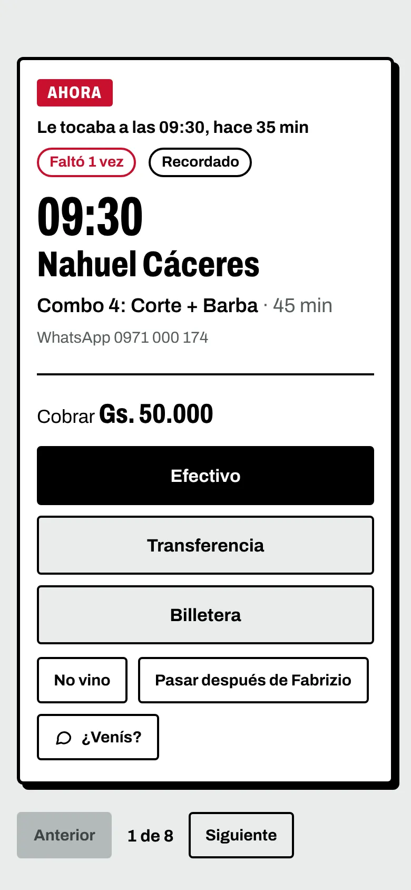
</p>

## 6. Cómo está hecho el sistema

### Tecnologías

| Parte | Tecnología |
|---|---|
| Sitio y panel | HTML, CSS y JavaScript, sin frameworks |
| Datos del prototipo | `localStorage` del navegador |
| Avisos | Enlaces de WhatsApp (`wa.me`) con el mensaje ya escrito |
| Versión publicada | Node.js con esbuild (minificación) y sharp (imágenes) |
| Pruebas | Python con Playwright (navegador automatizado) |
| Código y trabajo en equipo | Git y GitHub |
| Publicación | Render (sitio) y Aiven (base de datos PostgreSQL, para la próxima etapa) |

### Arquitectura

Es una sola página. El sitio de los clientes, «Mis turnos» y el panel del dueño son vistas de esa página, y se cambia de una a otra con la dirección (`#panel`, `#mis-turnos`). No hay servidor propio: todo corre en el navegador y los datos se guardan ahí mismo.

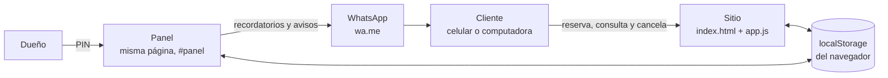

### Archivos

| Archivo o carpeta | Contenido |
|---|---|
| `index.html` | Estructura de la página: inicio, precios, cortes, reserva, horarios, cómo llegar y pie |
| `css/estilos.css` | Diseño para celular y computadora |
| `js/app.js` | Toda la lógica: datos del local, reserva, Mis turnos y panel |
| `img/`, `fuentes/` | Logo, fachada, fotos de la galería (`img/galeria/`), textura y tipografías |
| `herramientas/publicar.mjs` | Arma la versión optimizada que se publica |
| `herramientas/empaquetar.py` | Arma la versión en un solo archivo |
| `pruebas/` | Pruebas automáticas |
| `despliegue.yaml` | Configuración de publicación |

### Organización de `js/app.js`

El código está dentro de una función que se ejecuta sola, para no ensuciar el espacio global, y se divide en secciones:

1. **Datos del local:** servicios y combos (`SERVICIOS`), horario por día (`HORAS`), medios de pago, categorías de caja y unidades de stock. Es lo único que hay que tocar si cambia algo del local.
2. **Utilidades:** formato de guaraníes y fechas, hora de Paraguay, validación de teléfonos y armado de mensajes de WhatsApp.
3. **Turnos:** carga y guardado, cálculo de horarios libres y estado de cada turno.
4. **Cambios de horario:** los cierres y horarios especiales del dueño, y el cálculo del horario real de cada día (`horasDe`), que usan el sitio, la reserva y el panel.
5. **Datos de ejemplo:** agenda, caja, stock y un historial de seis meses para que el panel tenga contenido en la presentación.
6. **Sitio:** estado del local, precios, horarios y el asistente de reserva y de cambio de turno.
7. **Panel:** acceso con PIN y las vistas Atender, Hoy, Turnos, Caja, Stock, Precios, Horario, Clientes y Reportes.

La interfaz se arma con plantillas de texto y responde a los clics con un único manejador por zona, que lee el atributo `data-accion` del botón tocado.

### Datos que guarda

Mientras no haya base de datos, todo se guarda en el `localStorage` del navegador, en cuatro claves:

| Clave | Contenido |
|---|---|
| `tommybarber-reservas` | Turnos reservados desde ese navegador (lo que ve el cliente en «Mis turnos») |
| `tommybarber-panel` | Agenda, caja, productos y movimientos de stock del panel |
| `tommybarber-horario` | Cambios de horario: días cerrados, horas cerradas y horarios especiales |
| `tommybarber-precios` | Precios y duraciones que cambió el dueño, y el historial de cambios |

**Turno**

| Campo | Descripción |
|---|---|
| `codigo` | Código del comprobante, por ejemplo `TB-4821` |
| `servicio` | Servicio o combo reservado |
| `fecha`, `min` | Día (`AAAA-MM-DD`) y hora de inicio, en minutos desde la medianoche |
| `cliente`, `tel`, `nota` | Datos que deja el cliente |
| `precio`, `dur` | Precio y duración al momento de reservar |
| `estado` | `confirmado`, `atendido`, `novino` o `cancelado` |
| `medio` | Medio de pago, si se cobró |
| `canceladoPor`, `canceladoEn` | Quién lo canceló (`cliente` o `barberia`) y cuándo |
| `recordadoEn`, `avisadoEn` | Cuándo se mandó el recordatorio o el aviso de cancelación |
| `orden` | Lugar en la fila de Atender, si el dueño lo pasó después de otro |
| `sinTurno` | Si es alguien que llegó al local sin reservar |
| `antes`, `cambiadoEn` | Si el cliente lo cambió de día u hora: el horario anterior y cuándo lo cambió |

**Movimiento de caja:** fecha, hora, tipo (`entrada` o `salida`), categoría (servicio, venta de producto, compra de stock, gasto u otro ingreso), concepto, monto, medio de pago y, si corresponde, el turno que lo generó.

**Producto:** tipo (`insumo` o `venta`), nombre, presentación, unidad (por ejemplo, caja o cajas), cantidad, cantidad mínima y precio de venta.

**Movimiento de stock:** producto, tipo (`carga`, `compra`, `uso`, `venta`, `ajuste` o `baja`), cantidad, fecha y, según el caso, el costo, el monto o la cantidad antes y después.

**Cambio de precio:** servicio, campo (`precio` o duración), valor anterior, valor nuevo y fecha.

**Cambio de horario:** tipo (`cerrado`, `franja` o `especial`), fecha (y último día, si cierra varios), horas de inicio y fin, y motivo.

**Cliente:** no se guarda aparte. El panel lo arma juntando todos los turnos con el mismo número de WhatsApp (o el mismo nombre, si no dejó número).

### Reglas del negocio

- **Horario:** los turnos empiezan cada 30 minutos dentro de los horarios de atención, y un turno no puede terminar después del cierre del tramo (por ejemplo, de las 11:30).
- **Duración:** un turno ocupa los bloques de 30 minutos que necesita según su duración. Un combo de 60 minutos ocupa dos bloques.
- **Anticipación:** se reserva con al menos 15 minutos de anticipación y hasta 14 días adelante.
- **Doble control:** al confirmar, el sistema vuelve a revisar que el horario siga libre, por si otra persona lo reservó mientras tanto.
- **Teléfono:** se acepta solo un celular de Paraguay (`09XX XXX XXX`), en cualquier formato, y se guarda normalizado.
- **Hora de Paraguay:** el estado del local y los turnos se calculan con la hora de Asunción, aunque el dispositivo tenga otra zona horaria.
- **Precio fijo al reservar:** si el dueño cambia un precio, los turnos ya reservados mantienen el precio y la duración con que se reservaron.
- **Stock:** nunca se puede restar más de lo que hay. Si la cantidad llega al mínimo, aparece el aviso «hay que reponer».
- **Caja automática:** cobrar un turno o vender un producto genera una entrada en la caja, y comprar stock indicando el costo genera una salida.
- **Horario real del día:** al horario normal se le aplican los cambios del dueño. Un día cerrado no tiene horarios; un horario especial reemplaza al normal; una franja cerrada se descuenta. Así se calculan el estado del local, los horarios libres y el próximo día de atención.
- **Turnos afuera del horario:** si el dueño cierra un horario que ya tenía turnos, el sistema se los muestra para que los cancele y les avise por WhatsApp. No los cancela solo.
- **Cambio de turno:** el cliente lo puede cambiar mientras no haya empezado. Conserva el código, el precio y la duración; el horario anterior queda libre y el recordatorio se tiene que mandar de nuevo.
- **Prioridad del turno:** el turno reservado tiene prioridad; los que llegan sin turno se atienden en los huecos.

**Estados del turno**

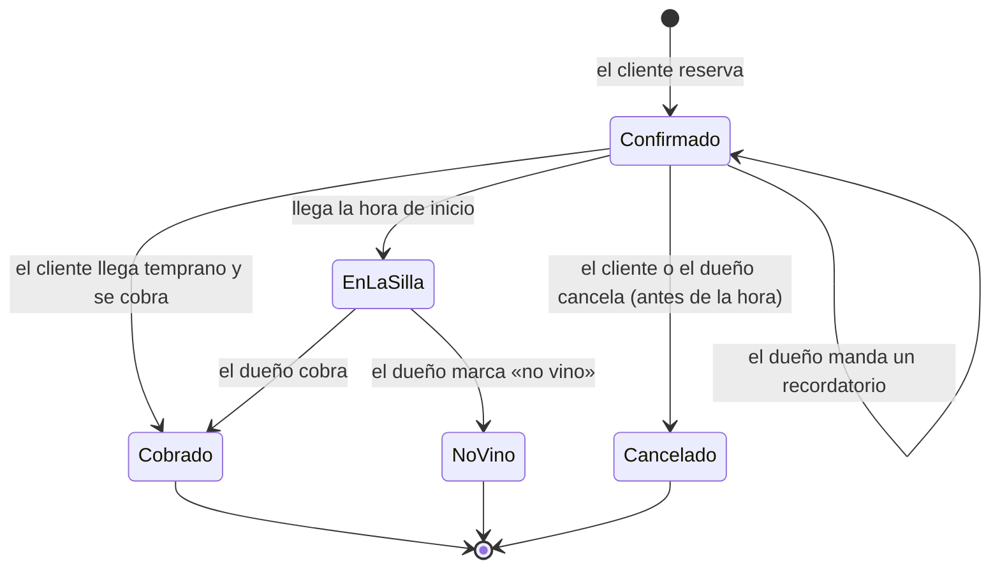

«En la silla» no se guarda como estado aparte: el sistema lo calcula cuando un turno confirmado llegó a su hora.

### Datos de ejemplo

Para que el panel se pueda mostrar sin esperar reservas reales, el sistema genera una agenda de ejemplo para hoy y los próximos días, un historial de turnos de los últimos seis meses (unos 500 clientes, algunos fijos y otros ocasionales, con faltas y cancelaciones), la caja de esos días y algunos movimientos de stock. Los datos se generan a partir de la fecha, así que el mismo día siempre muestra los mismos. Los turnos de ejemplo usan teléfonos `0981 000 …`: en esos, «Recordar» muestra el mensaje en pantalla en vez de abrir WhatsApp. El botón **Reiniciar datos de ejemplo** vuelve todo al principio.

## 7. Funcionalidades

### Sitio para clientes

**Inicio.** Muestra el nombre en graffiti, el logo oficial y el estado del local en tiempo real: «Abierto ahora», a qué hora cierra o cuándo vuelve a abrir. Si el visitante tiene un turno reservado, también aparece «Tenés turno…».

**Precios.** Divide la lista en servicios y combos. Cada uno muestra precio, duración aproximada y un botón «Reservar».

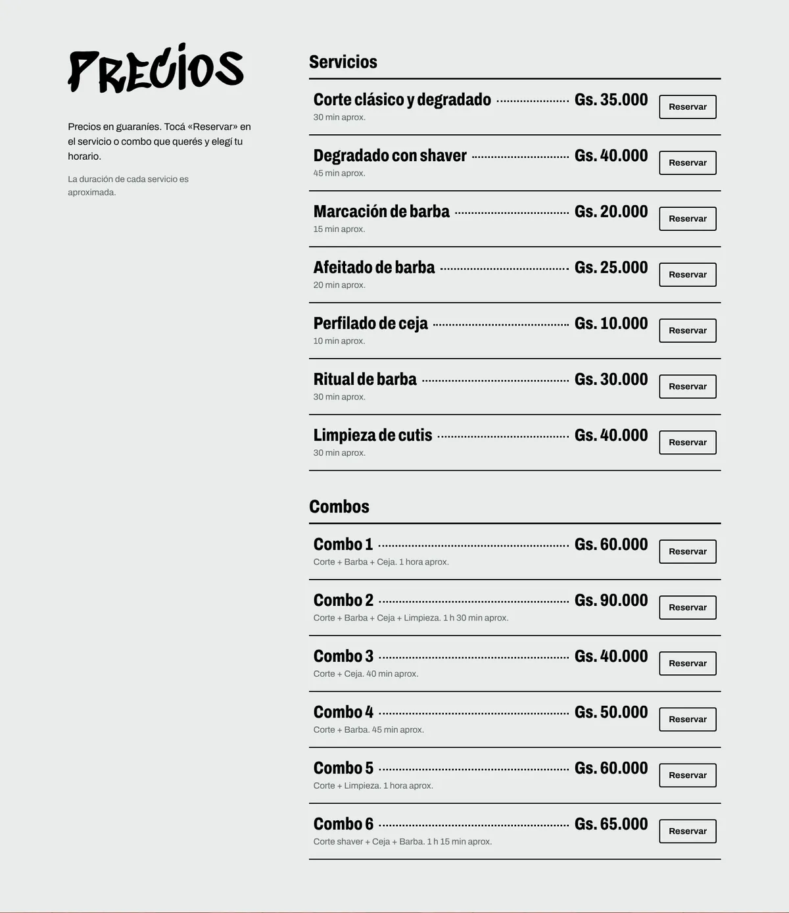

**Cortes.** Una galería con fotos de trabajos del local y el enlace al Instagram.


**Reserva en tres pasos.** El cliente elige el servicio, después el día y la hora (solo se muestran los horarios libres), y por último deja sus datos. Al terminar recibe un comprobante con el código del turno.

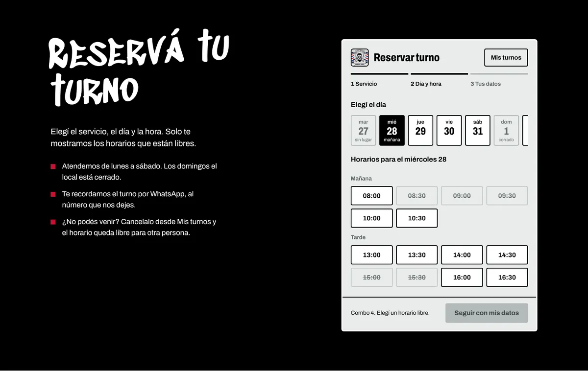


**Mis turnos.** Lista los turnos reservados desde ese celular. Mientras no hayan empezado, el cliente los puede cambiar de día u hora o cancelar, y el horario anterior queda libre para otra persona. Si la barbería canceló un turno, también se ve ahí.

**Cambiar día u hora.** Desde «Mis turnos», el cliente elige un nuevo día y horario sin cancelar y reservar de nuevo; su horario actual aparece marcado. El comprobante dice «Turno cambiado» y cuál era el horario anterior, y en el panel el dueño ve que el cliente lo cambió.


**Horarios y cómo llegar.** Muestran el horario de cada día, con el día de hoy resaltado, y arriba los cambios de las próximas dos semanas (por ejemplo, «Sábado 31 de octubre: cerrado todo el día. Feriado»). También están la foto de la fachada y los enlaces a Google Maps, WhatsApp (0972 496 916) e Instagram.

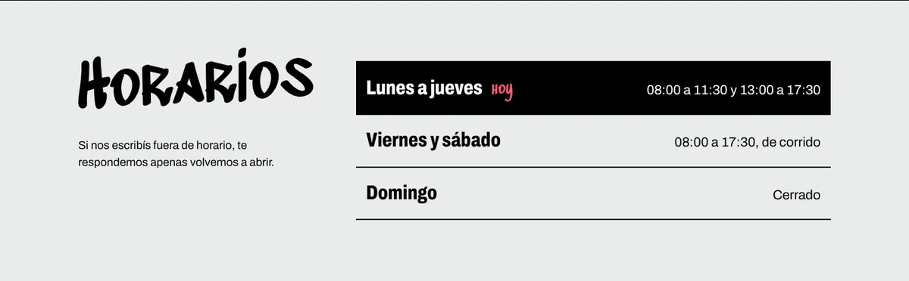

### Panel del dueño

Se entra con **Acceso del dueño**, al pie de la página. El PIN de prueba es **2121**.


**Atender.** Es la pantalla para usar mientras se corta. Al abrirla ya aparece, en grande, el cliente que corresponde ahora: el primero de la fila del día que todavía no se cobró. Muestra la hora, el nombre, el servicio, cuánto falta o cuánto atraso tiene, y los botones para resolverlo sin buscar nada:

- **Cobrar** con un solo toque, eligiendo el medio de pago: Efectivo, Transferencia o Billetera. El cobro entra solo a la caja.
- **No vino**, cuando ya pasó la hora del turno.
- **Pasar después de…**: si el cliente no llegó y llega el siguiente, el actual pasa detrás del siguiente, como en una fila por orden de llegada.
- **¿Venís?**: abre WhatsApp con «te estamos esperando» para el cliente atrasado.
- **Deshacer**, por si tocó algo sin querer.

Al lado se ven el siguiente y la fila completa del día. Para alguien que llega sin turno está **Llegó alguien sin turno**: se elige el servicio y se suma a la fila.

Todo se puede hacer con el teclado, sin el mouse:

| Tecla | Qué hace |
|---|---|
| Espacio o → | Pasa al siguiente de la fila |
| ← | Vuelve al anterior |
| Esc | Vuelve al cliente actual |
| 1, 2, 3 | Cobra en efectivo, por transferencia o con billetera |
| N | No vino |
| P | Lo pasa después del siguiente |
| A | Alguien sin turno |
| Z | Deshace lo último |

Con la dirección `…/#atender` se entra directo a esta pantalla: sirve para dejarla guardada en el celular o la computadora del local.


**Hoy.** Agenda completa del día en orden. Cada turno se puede cobrar eligiendo el medio de pago, marcar como «no vino» o cancelar. La pantalla también muestra lo que entró en el día y en la semana, y un aviso si mañana hay turnos sin recordatorio.

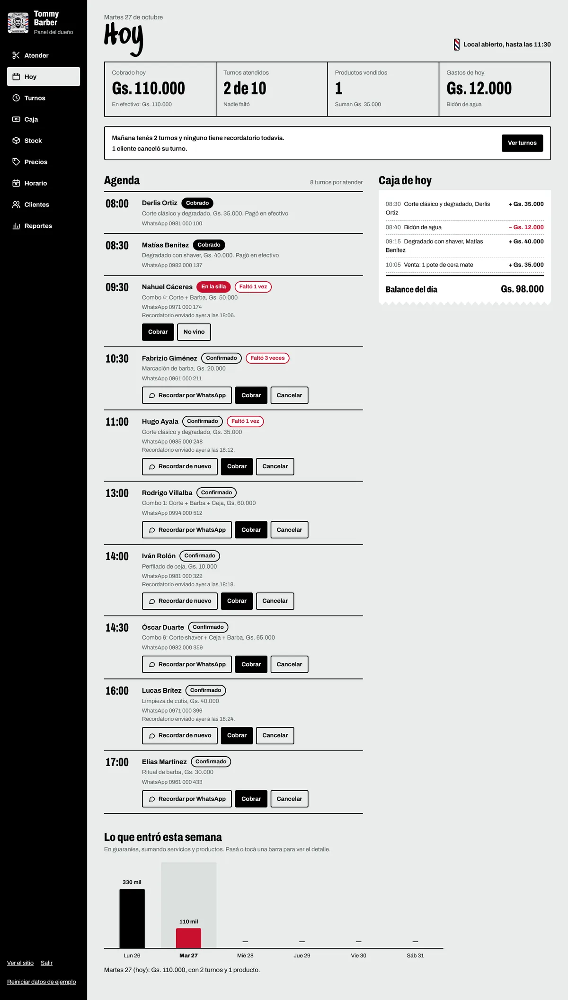

**Turnos.** Turnos de los próximos días agrupados por día. «Recordar por WhatsApp» abre WhatsApp con el mensaje listo para el número del cliente, y el dueño solo toca Enviar. Al cancelar, el sistema ofrece avisarle al cliente con otro mensaje preparado.


Mensajes que arma el sistema:

> Hola Juan, te recordamos tu turno de Combo 4 (corte + barba) en Tommy Barber: mañana miércoles 28 a las 08:00. Te esperamos en Constitución esquina, Quiindy. Si no podés venir, avisanos por acá. ¡Gracias!

> Hola Juan, te escribimos de Tommy Barber: tuvimos que cancelar tu turno de mañana miércoles 28 a las 08:00. ¿Te queda bien otro horario?

**Caja.** Muestra lo que entró, lo que salió y la ganancia de hoy, la semana o el mes, con el detalle de cada movimiento. Desde acá se anotan gastos y otros ingresos.


**Stock.** Lista los insumos del local y los productos para vender, con la cantidad disponible y el aviso de reposición. Por cada producto se puede registrar lo que se usó, lo que se vendió (con el medio de pago) y lo que se compró (con el costo), corregir datos o eliminarlo, y también se cargan productos nuevos.

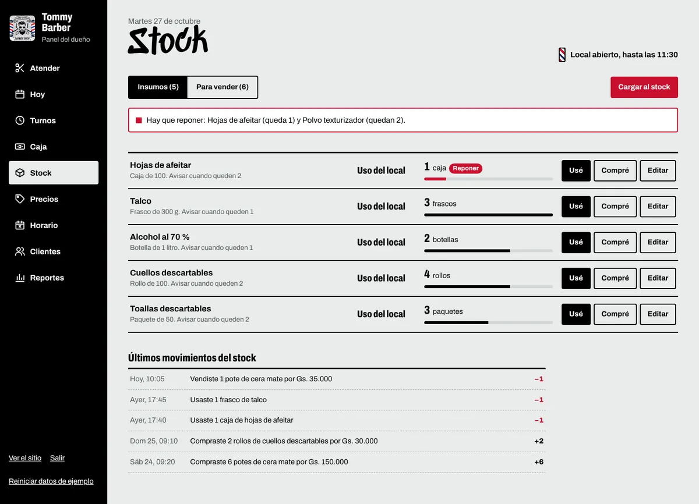

**Precios.** El dueño cambia el precio y la duración de cada servicio o combo. Las filas cambiadas muestran el valor anterior, y nada se aplica hasta tocar Guardar. El sitio se actualiza enseguida, los cambios quedan en un historial y se puede volver a la lista original del local.

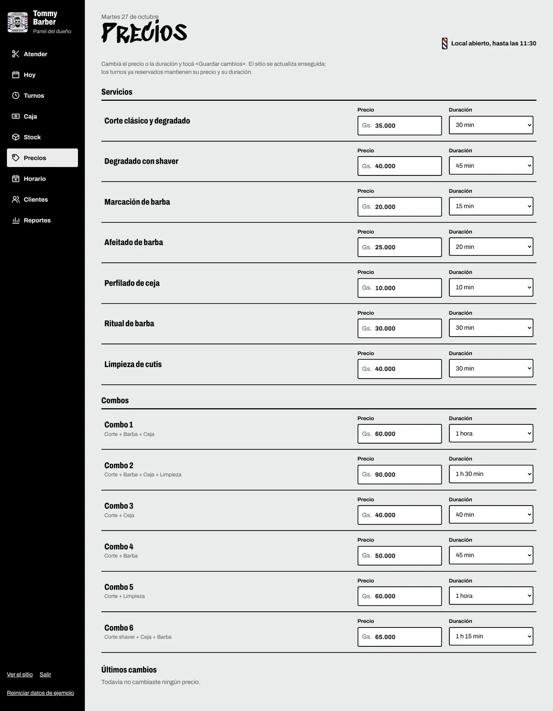

**Horario.** El dueño carga tres tipos de cambio:

- **Cerrar días:** uno o varios días seguidos, por ejemplo un feriado o vacaciones.
- **Cerrar horas:** una franja de un día, por ejemplo de 15:00 a 17:00 por un trámite.
- **Otro horario:** un día que abre distinto, aunque sea domingo.

Antes de guardar, el sistema avisa si hay turnos reservados en ese horario. Después los muestra debajo del cambio para cancelarlos y avisar a cada cliente por WhatsApp. El sitio deja de ofrecer esos horarios enseguida y los avisa en Horarios. Un cambio se puede quitar.


**Clientes.** Reúne a cada cliente por su número de WhatsApp. La lista se ordena por los que más vienen, los recientes o los que faltaron, y se busca por nombre o número. La ficha de cada cliente muestra:

- visitas, cuánto gastó, faltas y cancelaciones;
- desde cuándo es cliente, su último corte, su próximo turno y lo que más se hace;
- el historial de turnos.

Si un cliente faltó antes, Atender, Hoy y Turnos lo marcan con «Faltó 2 veces», para que el dueño decida si le confirma el turno. No se bloquea a nadie.

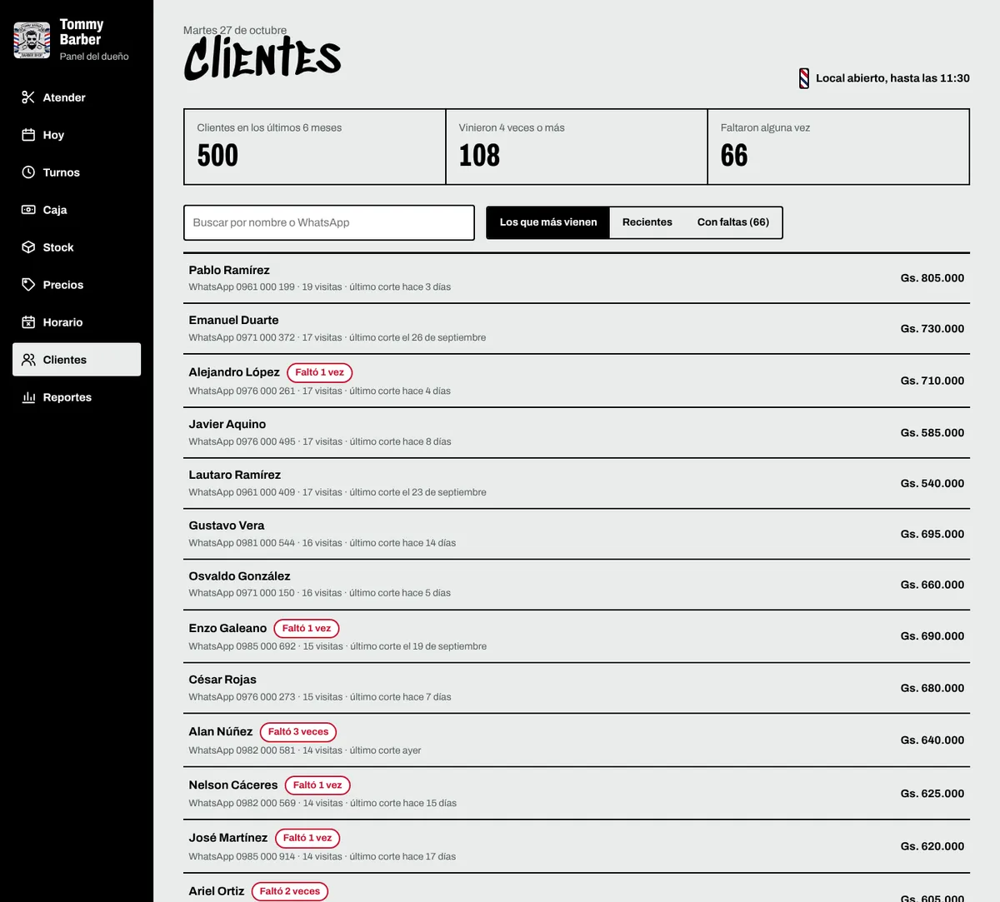

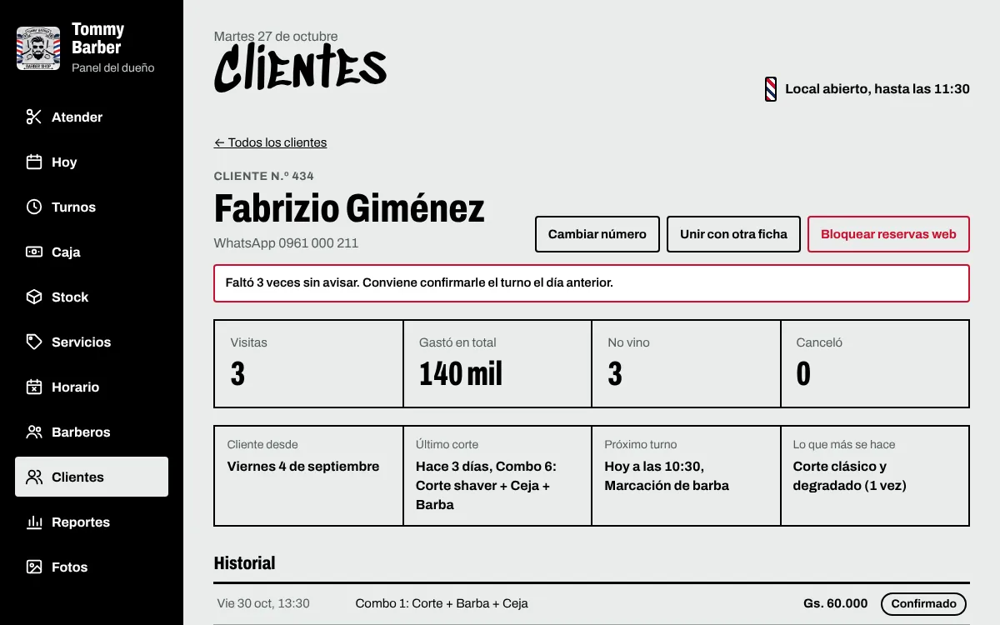

**Reportes.** Para las últimas 4 semanas, 3 meses o 6 meses, muestra tres cosas:

- **Días y horas con más clientes:** un mapa de calor de lunes a sábado, de 08:00 a 18:00, con el día y la hora con más movimiento.
- **Ganancia mes a mes:** lo que entró menos lo que salió de la caja en cada uno de los últimos seis meses.
- **Faltas y cancelaciones:** qué parte de los turnos no vino o se canceló, y los clientes que más faltan.


## 8. Velocidad y versión publicada

Lo que se publica no son los archivos originales sino una versión optimizada, que arma `npm run build` (`herramientas/publicar.mjs`):

- El CSS va dentro del HTML, así la página se dibuja sin esperar otro archivo.
- El CSS y el JavaScript van minificados.
- Las imágenes se convierten a AVIF y WebP. Las fotos de la fachada y de la galería salen en varios tamaños para que cada pantalla baje la que necesita, y se cargan recién cuando la página llega a esa parte.
- Las tipografías y el logo se piden apenas llega la página.
- La tipografía Archivo se recortó a los anchos y pesos que usa el sitio: pasó de 88 KB a 58 KB.
- Los archivos llevan un hash en el nombre, así el navegador los guarda un año y baja los nuevos solo cuando cambian.

Medición con Lighthouse en modo celular, con conexión móvil simulada:

| Indicador | Antes | Después |
|---|---|---|
| Puntaje de rendimiento | 92 | 99 |
| Primer contenido visible (FCP) | 1,65 s | 0,97 s |
| Elemento principal visible (LCP) | 3,30 s | 1,95 s |
| Bloqueo del navegador (TBT) | 45 ms | 0 ms |
| Peso total de la página | 413 KB | 171 KB |

## 9. Pruebas

La carpeta `pruebas/` tiene cuatro recorridos automáticos con Playwright, que abren el sitio en un navegador real con el reloj fijo en el martes 27/10/2026 a las 10:05 (hora de Paraguay). Cada recorrido se hace en computadora y en celular.

- **`probar_todo.py`** (50 comprobaciones por pantalla) prueba:
  - los precios oficiales;
  - una reserva completa y su comprobante;
  - que un teléfono que no es celular no deje confirmar;
  - «Mis turnos», la cancelación por el cliente y que el horario quede libre;
  - el acceso con PIN;
  - cobrar un turno, y cancelar uno con aviso por WhatsApp;
  - los recordatorios y la vista previa de los mensajes de ejemplo;
  - el stock: cargar, usar, vender y comprar, y que no deje usar más de lo que hay;
  - que las ventas y compras del stock lleguen a la caja;
  - que no haya errores en la consola.
- **`probar_atender.py`** prueba la pantalla Atender: la entrada directa con `#atender`, moverse con Espacio y las flechas, cobrar con la tecla 1 y que entre a la caja, deshacer, pasar a alguien después del siguiente, «no vino» solo después de la hora, sumar a alguien sin turno y vaciar la fila.
- **`probar_mejoras.py`** prueba la galería y el WhatsApp del local; el cambio de turno desde «Mis turnos» y que el dueño lo vea; los cambios de horario (cerrar un día con turnos, avisar a los afectados, que el sitio y la reserva lo respeten, cerrar unas horas, abrir un domingo y quitar un cambio); los clientes (lista, búsqueda, ficha y faltas en Atender) y los reportes.
- **`probar_precios.py`** prueba el cambio de precios desde el panel: la validación, el guardado, el historial, el sitio actualizado, que los turnos reservados conserven su precio y la vuelta a la lista original.

Cómo correrlas:

```
pip install playwright
python -m playwright install chromium
python pruebas/probar_todo.py
python pruebas/probar_precios.py
python pruebas/probar_atender.py
python pruebas/probar_mejoras.py
```

También se pueden correr contra la versión publicada, pasando la dirección como argumento. Las capturas quedan en `pruebas/capturas/`.

## 10. Publicación y base de datos

- El sitio se publica en **Render** como sitio estático. Cada cambio que se une a `main` en GitHub arma la versión optimizada y la publica sola.
- Para la próxima etapa se creó una base de datos **PostgreSQL** en **Aiven**, todavía vacía. Ahí se van a guardar los turnos, la caja y el stock cuando el sistema tenga servidor.

## 11. Trabajo en equipo

El código está en un repositorio privado de GitHub con los integrantes del grupo como colaboradores. Cada cambio se hace en una rama y entra a `main` por un Pull Request:

| Pull Request | Contenido |
|---|---|
| #1 | Precios oficiales, cancelación de turnos con aviso por WhatsApp, stock del dueño y precios editables desde el panel |
| #2 | Versión optimizada para publicar y configuración de publicación |
| #3 | Esta documentación y las pruebas automáticas |
| #4 | Pantalla Atender |
| #5 | Cambios de horario, clientes, reportes, galería, WhatsApp del local y cambio de turno |

## 12. Limitaciones y próximos pasos

**Limitaciones del prototipo**

- Los datos viven en cada navegador. Un turno que reserva un cliente desde su celular no le llega al panel del dueño en otro dispositivo. Para eso hace falta el servidor y la base de datos de la próxima etapa.
- El PIN del panel es de prueba y está en el código. Con el servidor, el acceso tiene que validarse del lado del servidor.
- Los mensajes de WhatsApp los envía el dueño a mano: el sistema solo abre WhatsApp con el texto listo.
- Hay una sola agenda. Si trabaja más de un barbero, hace falta una agenda por barbero y que el cliente pueda elegir con quién (o «el que esté libre»). Queda pendiente hasta confirmarlo con el dueño.

**Próximos pasos**

1. Diseñar la base de datos: turnos, clientes, servicios, caja, stock y cambios de precio.
2. Hacer el servidor (API) que guarde y lea esos datos, y conectar el sitio y el panel.
3. Confirmar con el dueño:
   - qué incluye «Barba» en los combos;
   - la calle que cruza con Constitución;
   - cuántos barberos atienden y cómo trabajan con el dueño;
   - en qué dispositivo va a usar el panel;
   - los productos e insumos que usa y vende;
   - las formas de pago que acepta;
   - el permiso para usar el logo y la foto.
