# Tommy Barber: documentación del proyecto

Trabajo de campo: sitio web con reserva de turnos y panel de administración para **Tommy Barber**, barbería de Quiindy, Paraguay (Constitución esquina).

- **Sitio publicado:** https://tommy-barber.onrender.com
- **Código:** este repositorio. Cómo abrirlo y probarlo está en el [README](../README.md).
- **Período documentado:** del 20 de octubre al 23 de noviembre de 2026.
- **Base de datos:** su diseño está en [BASE_DE_DATOS.md](BASE_DE_DATOS.md).

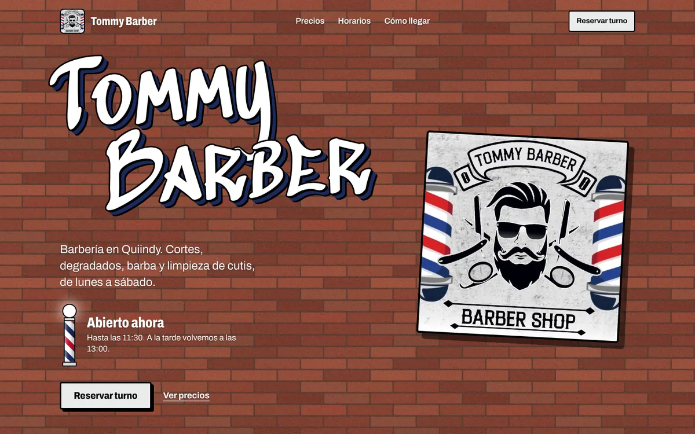

## Contenido

1. [El negocio y el problema](#1-el-negocio-y-el-problema)
2. [Relevamiento](#2-relevamiento)
3. [Requerimientos](#3-requerimientos)
4. [Recorrido del proyecto](#4-recorrido-del-proyecto)
5. [Diseño visual](#5-diseño-visual)
6. [Cómo está hecho el sistema](#6-cómo-está-hecho-el-sistema)
7. [Funcionalidades](#7-funcionalidades)
8. [Velocidad y versión publicada](#8-velocidad-y-versión-publicada)
9. [Pruebas](#9-pruebas)
10. [Publicación y base de datos](#10-publicación-y-base-de-datos)
11. [Trabajo en equipo](#11-trabajo-en-equipo)
12. [Limitaciones y próximos pasos](#12-limitaciones-y-próximos-pasos)

## 1. El negocio y el problema

Tommy Barber es una barbería de barrio en Quiindy. Hoy los clientes piden turno por WhatsApp o Instagram, y fuera de horario les responde un contestador automático. El dueño no tiene un lugar donde ver la agenda del día, anotar lo que cobra ni controlar los productos que usa y vende.

El proyecto propone un sistema web con dos partes:

- **Un sitio para los clientes:** muestra precios, horarios y cómo llegar, y permite reservar un turno sin escribirle a nadie.
- **Un panel para el dueño:** reúne la agenda, la caja, el stock y los precios, y desde ahí puede avisarles a los clientes por WhatsApp.

## 2. Relevamiento

Antes de la entrevista con el dueño, se trabajó con la información pública del local:

| Fuente | Qué aportó |
|---|---|
| Contestador automático de WhatsApp | Horario de atención: de lunes a jueves de 08:00 a 11:30 y de 13:00 a 17:30; viernes y sábados de 08:00 a 17:30 de corrido; domingos cerrado. |
| Perfil de Google Maps | Ubicación del local y enlace para llegar. |
| Instagram @tommybarber21 | Logo oficial y estilo de la marca. |
| Foto de la fachada | Persiana blanca con el logo del barbudo, postes de barbería y pared de ladrillo: de ahí sale el estilo del sitio. |
| Lista de precios oficial | 7 servicios y 6 combos, vigentes desde noviembre de 2026. |

**Lista de precios oficial**

| Servicio o combo | Precio |
|---|---|
| Corte clásico y degradado | Gs. 35.000 |
| Degradado con shaver | Gs. 40.000 |
| Marcación de barba | Gs. 20.000 |
| Afeitado de barba | Gs. 25.000 |
| Perfilado de ceja | Gs. 10.000 |
| Ritual de barba | Gs. 30.000 |
| Limpieza de cutis | Gs. 40.000 |
| Combo 1: Corte + Barba + Ceja | Gs. 60.000 |
| Combo 2: Corte + Barba + Ceja + Limpieza | Gs. 90.000 |
| Combo 3: Corte + Ceja | Gs. 40.000 |
| Combo 4: Corte + Barba | Gs. 50.000 |
| Combo 5: Corte + Limpieza | Gs. 60.000 |
| Combo 6: Corte shaver + Ceja + Barba | Gs. 65.000 |

La lista no indica cuánto dura cada servicio. Las duraciones del sistema son estimadas y quedan para confirmar con el dueño, junto con los demás puntos de la [sección 12](#12-limitaciones-y-próximos-pasos).

## 3. Requerimientos

### Funcionales

**Cliente**

- Ver precios, horarios, ubicación e Instagram del local.
- Saber si el local está abierto en este momento.
- Reservar un turno: elegir servicio o combo, con qué barbero (o «el que esté libre»), día y hora libre, y dejar nombre y WhatsApp.
- Reservar para un hijo o para alguien sin celular, con el propio WhatsApp.
- Recibir un comprobante con el código del turno.
- Ver sus turnos, cambiarlos de día u hora o cancelarlos mientras no hayan empezado.
- Ver trabajos del local y escribirle por WhatsApp.

**Dueño**

- Entrar al panel con usuario y contraseña, desde una dirección aparte que los clientes no ven.
- Darle a cada barbero su propio acceso, en el que vea solo sus turnos y sus cobros.
- Atender rápido mientras corta: ver de un vistazo el turno que corresponde ahora y el siguiente, y cobrar, marcar «no vino» o pasarlo después con un toque o una tecla.
- Sumar a la fila a alguien que llega sin turno, ya que el dueño atiende por orden de llegada. El sistema le da la primera hora libre que queda en el día (o la que se elija entre las libres) y, si hoy ya no hay lugar, le ofrece las horas libres del próximo día.
- Tomarle el WhatsApp al que llega sin turno y se va, para avisarle cuando le falte un cliente.
- Ver la agenda del día; cobrar cada turno indicando el medio de pago, marcar «no vino» o cancelar.
- Ver los turnos de los próximos días y mandar recordatorios por WhatsApp.
- Cancelar un turno y avisarle al cliente por WhatsApp.
- Anotar gastos y otros ingresos, y ver lo que entró, lo que salió y la ganancia del día, la semana o el mes.
- Cargar insumos y productos para vender; restar lo que usa o vende y sumar lo que compra.
- Agregar servicios y combos con su precio y duración, cambiarlos y dejar de ofrecer los que ya no hace.
- Agregar, editar y quitar barberos, cada uno con sus días y horas; en Atender, cada barbero tiene su botón para ver su fila.
- Cambiar las fotos de la página: el logo, la foto del local y las fotos de cortes.
- Protegerse de los turnos falsos: un tope de turnos pendientes por persona, por número y por celular, bloquear números y cancelar un turno como falso.
- Cerrar días u horas, o abrir con otro horario un día puntual, sin que el sitio ofrezca esos turnos. Cerrar días u horas solo para un barbero.
- Conocer a sus clientes: cuántas veces vinieron, qué se hacen, cuánto gastaron y si faltan.
- Tener una sola ficha por cliente: que no se dupliquen, cambiarle el número si cambia de celular y juntar dos fichas que resultan ser de la misma persona.
- Ver reportes: días y horas con más clientes, ganancia mes a mes, faltas y cancelaciones.

### No funcionales

- Estilo urbano, con letras de graffiti, que no parezca una plantilla genérica.
- Pensado primero para celular: la mayoría de los clientes entra desde el teléfono.
- Rápido aun con conexión móvil.
- Textos reales del local, sin textos de relleno.
- Horarios calculados con la hora de Paraguay, sin importar la zona horaria del dispositivo.

## 4. Recorrido del proyecto

| Fecha | Etapa | Resultado |
|---|---|---|
| 20/10/2026 | Relevamiento y primer diseño | Sitio con estilo urbano, reserva de turnos y panel del dueño con caja y productos. |
| 20/10/2026 | Ajustes | Logo oficial completo, acceso al panel corregido (sitio y panel en la misma página) y versión en un solo archivo para presentar sin internet. |
| 20/10/2026 | Repositorio | Repositorio privado en GitHub para trabajar en equipo. |
| 27/10/2026 | Precios, turnos y stock | Lista oficial de precios; «Mis turnos» con cancelación; recordatorios y avisos por WhatsApp; stock de insumos y productos. Se redactaron los enunciados para los diagramas UML. |
| 27/10/2026 | Precios desde el panel | El dueño cambia precios y duraciones; los turnos ya reservados conservan su precio. |
| 27/10/2026 | Publicación | Versión optimizada, sitio publicado y base de datos PostgreSQL creada, vacía, para la próxima etapa. |
| 27/10/2026 | Documentación | Este documento y las pruebas automáticas en el repositorio. |
| 28/10/2026 | Pantalla Atender | El turno actual y el siguiente en una sola pantalla, con atajos de teclado, deshacer y clientes sin turno. |
| 28/10/2026 | Cuestionario de mejoras | Se definieron las mejoras siguientes y se confirmó el WhatsApp del local. Las duraciones quedan aproximadas porque ni el dueño las conoce con exactitud. |
| 28/10/2026 | Mejoras del panel y del sitio | Cambios de horario, fichas de clientes con aviso de faltas, reportes, galería de cortes, WhatsApp del local y cambio de turno desde «Mis turnos». |
| 31/10/2026 | Sin turno y registro de clientes | El que llega sin turno recibe la primera hora libre del día y puede dejar su WhatsApp para que le avisen. Cada cliente tiene un número interno; se detectan fichas repetidas, se unen y se cambia el número sin perder el historial. El mapa de calor de Reportes tiene leyenda. |
| 23/11/2026 | Barberos, servicios, fotos y base de datos | Barberos con sus días y horas, reserva con barbero, una fila por barbero en Atender, intercambio de horas al pasar a alguien después, servicios nuevos, fotos editables y protección contra turnos falsos. Base de datos PostgreSQL diseñada a partir del sistema, creada y probada. |

## 5. Diseño visual

La identidad sale de la fachada del local: pared de ladrillo, persiana metálica, postes de barbería y el logo del barbudo.

| Elemento | Decisión |
|---|---|
| Fondo del inicio y del pie | Textura de ladrillo, como la pared del local. |
| Títulos | **Sedgwick Ave Display**, una tipografía de graffiti, con borde negro y sombra azul en capas, inclinada como una pintada. |
| Texto | **Archivo**, una tipografía variable que se usa normal y condensada. |
| Colores | Chapa `#E9ECEB`, rojo `#C8102E`, azul `#1B2A5C`, negro y ladrillo `#814535`: los colores del poste de barbería y de la fachada. |
| Estado del local | Un poste de barbería dibujado con CSS que indica si el local está abierto. |
| Botones de WhatsApp | Verde de WhatsApp solo en las acciones urgentes, como recordar los turnos de mañana, para que no compitan con el resto. |
| Galería de cortes | Fotos de trabajos pegadas con cinta sobre la pared de ladrillo, como pósteres. |

<p>
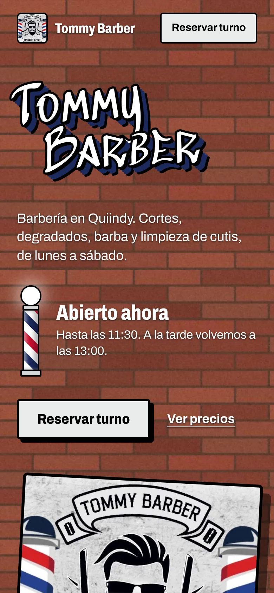

</p>

## 6. Cómo está hecho el sistema

### Tecnologías

| Parte | Tecnología |
|---|---|
| Sitio y panel | HTML, CSS y JavaScript, sin frameworks |
| Servidor (API) | Node.js 22 con Express (ver [API.md](API.md)) |
| Datos en modo demostración | `localStorage` del navegador |
| Avisos | Enlaces de WhatsApp (`wa.me`) con el mensaje ya escrito |
| Versión publicada | Node.js con esbuild (minificación) y sharp (imágenes) |
| Pruebas | Python con Playwright (navegador automatizado) |
| Código y trabajo en equipo | Git y GitHub |
| Base de datos | PostgreSQL: tablas, restricciones y vistas en `base-de-datos/` |
| Publicación | Render (sitio) y Aiven (base de datos) |

### Arquitectura

Es una sola página. El sitio de los clientes, «Mis turnos» y el panel son vistas de esa página. Los datos están en una base PostgreSQL y la página los pide y los guarda a través de la API (`servidor/`).

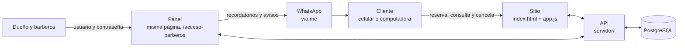

- **Con la base de datos** (la página publicada): el panel se abre solo en `/acceso-barberos`, con usuario y contraseña, y no hay botón de acceso en la página de los clientes. El dueño ve todo; cada barbero ve Atender, Hoy y Turnos con sus propios turnos. Los turnos que reserva un cliente le aparecen al panel en todos los celulares en menos de 15 segundos. Cómo funciona, la seguridad y las direcciones de la API están en [API.md](API.md).
- **En modo demostración** (abriendo `index.html` desde la carpeta, en `localhost` o con `?demo`): funciona sin servidor, con datos de ejemplo guardados en el navegador y el panel en `#panel` con el PIN 2121.

### Archivos

| Archivo o carpeta | Contenido |
|---|---|
| `index.html` | Estructura de la página: inicio, precios, cortes, reserva, horarios, cómo llegar y pie |
| `css/estilos.css` | Diseño para celular y computadora |
| `js/app.js` | Toda la lógica: datos del local, reserva, Mis turnos y panel |
| `img/`, `fuentes/` | Logo, fachada, fotos de la galería (`img/galeria/`), textura y tipografías |
| `herramientas/publicar.mjs` | Arma la versión optimizada que se publica |
| `herramientas/empaquetar.py` | Arma la versión en un solo archivo |
| `herramientas/capturas.py` | Saca las capturas del panel de esta documentación |
| `base-de-datos/` | Base de datos: esquema (`01-esquema.sql`) y datos iniciales del local (`02-datos-iniciales.sql`) |
| `pruebas/` | Pruebas automáticas |
| `despliegue.yaml` | Configuración de publicación |

### Organización de `js/app.js`

El código está dentro de una función que se ejecuta sola, para no ensuciar el espacio global, y se divide en secciones:

1. **Datos del local:** servicios y combos (`SERVICIOS`), horario por día (`HORAS`), medios de pago, categorías de caja y unidades de stock. Es lo único que hay que tocar si cambia algo del local.
2. **Utilidades:** formato de guaraníes y fechas, hora de Paraguay, validación de teléfonos y armado de mensajes de WhatsApp.
3. **Turnos:** carga y guardado, cálculo de horarios libres y estado de cada turno.
4. **Barberos y cambios de horario:** los barberos con sus días y horas, los cierres y horarios especiales del dueño, y el cálculo del horario real de cada día (`horasDe`) y de cada barbero (`horasBarbero`), que usan el sitio, la reserva y el panel.
5. **Datos de ejemplo:** agenda, caja, stock y un historial de seis meses para que el panel tenga contenido en la presentación.
6. **Sitio:** estado del local, precios, horarios, fotos y el asistente de reserva y de cambio de turno, con los topes contra turnos falsos.
7. **Panel:** acceso (usuario y contraseña, o PIN en modo demostración) y las vistas Atender, Hoy, Turnos, Caja, Stock, Servicios, Horario, Barberos, Clientes, Reportes y Fotos.
8. **Conexión con la base de datos:** carga lo que manda la API, manda solo lo que cambió, trae las novedades de los otros celulares y el ingreso con contraseña (solo con la base de datos).

La interfaz se arma con plantillas de texto y responde a los clics con un único manejador por zona, que lee el atributo `data-accion` del botón tocado.

### Datos que guarda

Con la base de datos, todo se guarda en PostgreSQL (ver [BASE_DE_DATOS.md](BASE_DE_DATOS.md)) y el celular guarda solo la sesión del panel, los códigos y claves de «Mis turnos» y qué barbero usa Atender. En modo demostración, todo se guarda en el `localStorage` del navegador, en siete claves (y una octava, `tommybarber-atender`, recuerda qué barbero usa Atender en cada celular):

| Clave | Contenido |
|---|---|
| `tommybarber-reservas` | Turnos reservados desde ese navegador (lo que ve el cliente en «Mis turnos») |
| `tommybarber-panel` | Agenda, caja, productos y movimientos de stock del panel |
| `tommybarber-horario` | Cambios de horario: días cerrados, horas cerradas y horarios especiales |
| `tommybarber-precios` | Servicios agregados, los que no se ofrecen, los precios y duraciones cambiados, y el historial |
| `tommybarber-barberos` | Barberos, con sus días y horas, y los que ya no trabajan |
| `tommybarber-fotos` | Logo, foto del local y fotos de cortes que cambió el dueño (achicadas, en WebP) |
| `tommybarber-clientes` | Registro de clientes: el número interno de cada uno, sus números anteriores, las fichas unidas, los pares que el dueño confirmó que son personas distintas y los números bloqueados |

**Turno**

| Campo | Descripción |
|---|---|
| `codigo` | Código del comprobante, por ejemplo `TB-4821` |
| `servicio` | Servicio o combo reservado |
| `barbero` | Con qué barbero es |
| `fecha`, `min` | Día (`AAAA-MM-DD`) y hora de inicio, en minutos desde la medianoche |
| `cliente`, `tel`, `nota` | Datos que deja el cliente |
| `precio`, `dur` | Precio y duración al momento de reservar |
| `estado` | `confirmado`, `atendido`, `novino` o `cancelado` |
| `medio` | Medio de pago, si se cobró |
| `canceladoPor`, `canceladoEn` | Quién lo canceló (`cliente` o `barberia`) y cuándo |
| `recordadoEn`, `avisadoEn` | Cuándo se mandó el recordatorio o el aviso de cancelación |
| `pospuesto` | Si el dueño lo pasó después del siguiente (se intercambiaron las horas) |
| `falso` | Si se canceló como turno falso |
| `sinTurno`, `llego` | Si es alguien que llegó al local sin reservar, y a qué hora llegó (`min` es la hora libre que se le dio) |
| `llamadoEn` | Cuándo se le avisó por WhatsApp que ya le tocaba, si se fue y dejó su número |
| `enLocal` | Si el turno lo anotó el dueño en el local (por ejemplo, para otro día porque hoy no había lugar) |
| `antes`, `cambiadoEn` | Si el cliente lo cambió de día u hora: el horario anterior y cuándo lo cambió |

**Movimiento de caja:** fecha, hora, tipo (`entrada` o `salida`), categoría (servicio, venta de producto, compra de stock, gasto u otro ingreso), concepto, monto, medio de pago y, si corresponde, el turno que lo generó.

**Producto:** tipo (`insumo` o `venta`), nombre, presentación, unidad (por ejemplo, caja o cajas), cantidad, cantidad mínima y precio de venta.

**Movimiento de stock:** producto, tipo (`carga`, `compra`, `uso`, `venta`, `ajuste` o `baja`), cantidad, fecha y, según el caso, el costo, el monto o la cantidad antes y después.

**Servicio:** grupo (servicio o combo), nombre, qué incluye (combos), precio, duración y si se ofrece. Los de la lista del local tienen además su precio y duración originales; los que agrega el dueño quedan marcados como agregados. Un servicio nunca se borra: si se deja de ofrecer, los turnos viejos siguen mostrando su nombre.

**Cambio de servicio:** servicio, campo (precio, duración, nombre, nuevo, dejó de ofrecerse o vuelve), valor anterior, valor nuevo y fecha.

**Barbero:** nombre, si trabaja todavía y, para cada día de la semana, desde y hasta qué hora atiende. Quitar a un barbero no lo borra, para que sus cortes sigan en los reportes.

**Cambio de horario:** tipo (`cerrado`, `franja` o `especial`), fecha (y último día, si cierra varios), horas de inicio y fin, motivo y, si es solo para uno, el barbero.

**Foto:** dónde va (logo, local o galería), la imagen achicada, su tamaño, qué se ve en ella y el orden en la galería. La galería puede mezclar fotos nuevas con las que trae la página.

**Cliente:** cada cliente tiene un **número interno** (N.º 1, 2, 3…), que es su clave y nunca cambia. Un turno es de un cliente cuando coinciden el WhatsApp **y** el nombre y apellido (sin importar mayúsculas ni acentos); si no dejó número, se usa solo el nombre. Se eligió así y no el teléfono como clave por dos motivos:

- Un papá que reserva para su hijo con su propio número tiene que quedar como dos clientes distintos.
- Si un cliente cambia de número, con el teléfono como clave habría que cambiarlo en todos sus turnos. Con un número interno, se cambia un solo dato y el anterior queda guardado.

En la base de datos esto queda como una tabla `cliente` con un `id` como clave primaria y una restricción `UNIQUE (telefono, nombre_normalizado)`, una tabla `cliente_telefono_anterior` con los números viejos, y una clave foránea `cliente_id` en cada turno. El diseño completo está en [BASE_DE_DATOS.md](BASE_DE_DATOS.md).

### Reglas del negocio

- **Horario:** los turnos empiezan cada 30 minutos dentro de los horarios de atención, y un turno no puede terminar después del cierre del tramo (por ejemplo, de las 11:30).
- **Duración:** un turno ocupa los bloques de 30 minutos que necesita según su duración. Un combo de 60 minutos ocupa dos bloques.
- **Anticipación:** se reserva con al menos 15 minutos de anticipación y hasta 14 días adelante.
- **Doble control:** al confirmar, el sistema vuelve a revisar que el horario siga libre, por si otra persona lo reservó mientras tanto.
- **Teléfono:** se acepta solo un celular de Paraguay (`09XX XXX XXX`), en cualquier formato, y se guarda normalizado.
- **Hora de Paraguay:** el estado del local y los turnos se calculan con la hora de Asunción, aunque el dispositivo tenga otra zona horaria.
- **Precio fijo al reservar:** si el dueño cambia un precio, los turnos ya reservados mantienen el precio y la duración con que se reservaron.
- **Stock:** nunca se puede restar más de lo que hay. Si la cantidad llega al mínimo, aparece el aviso «hay que reponer».
- **Caja automática:** cobrar un turno o vender un producto genera una entrada en la caja, y comprar stock indicando el costo genera una salida.
- **Horario real del día:** al horario normal se le aplican los cambios del dueño. Un día cerrado no tiene horarios; un horario especial reemplaza al normal; una franja cerrada se descuenta. Así se calculan el estado del local, los horarios libres y el próximo día de atención.
- **Turnos afuera del horario:** si el dueño cierra un horario que ya tenía turnos, el sistema se los muestra para que los cancele y les avise por WhatsApp. No los cancela solo.
- **Cambio de turno:** el cliente lo puede cambiar mientras no haya empezado. Conserva el código, el precio y la duración; el horario anterior queda libre y el recordatorio se tiene que mandar de nuevo.
- **Prioridad del turno:** el turno reservado tiene prioridad; los que llegan sin turno se atienden en los huecos.
- **Agenda por barbero:** cada barbero tiene su agenda. Un turno ocupa solo la del suyo, así a la misma hora puede haber un turno con cada barbero.
- **Horario del barbero:** atiende en sus días y horas, recortados al horario del local (por ejemplo, de lunes a jueves no se dan turnos de 11:30 a 13:00). Un día que el local abre con otro horario (por ejemplo, un domingo), atienden todos en ese horario, salvo un cierre propio.
- **«El que esté libre»:** de los barberos libres a esa hora, el turno va al que tiene menos turnos ese día. Si empatan, al primero de la lista.
- **Quitar un barbero:** primero hay que pasar sus turnos pendientes a otro barbero (los que no entran en su horario se muestran para cambiarlos o cancelarlos). Tiene que quedar al menos uno.
- **«Pasar después»:** se intercambian las horas. Si el de las 09:30 no llegó y se lo pasa después del de las 10:30, el de las 10:30 queda a las 09:30 y el que no llegó a las 10:30. Se puede deshacer.
- **Tope de turnos (contra turnos falsos):** una persona (mismo WhatsApp y mismo nombre) puede tener un solo turno pendiente; un mismo WhatsApp, hasta 4, para que un papá pueda reservar para sus hijos sin celular; y un mismo celular, también hasta 4. Para más, el sitio pide escribir al WhatsApp del local.
- **Número bloqueado:** no puede reservar por la web (tampoco las otras personas que reservan con ese número); el dueño lo puede anotar igual en el local. «Es falso: cancelar y bloquear» cancela el turno sin mandar aviso, bloquea el número y ofrece cancelar los otros turnos pendientes de ese número.
- **Servicios:** un servicio nuevo necesita nombre (sin repetir), precio y duración; un combo, además, qué incluye. Tiene que quedar al menos un servicio que se ofrezca.
- **Fotos:** se achican antes de guardarse (logo hasta 512 px, foto del local hasta 1280 px, fotos de cortes hasta 1000 px) y se guardan en WebP. La galería tiene hasta 8 fotos.
- **Hora del que llega sin turno:** se le da la primera hora libre de la grilla de 30 minutos que queda en el día, contando la duración del servicio. La hora en curso todavía cuenta si empezó hace 10 minutos o menos y está libre. Los turnos ya cobrados o que no vinieron dejan su hora libre. Si hoy no entra, se ofrecen las horas libres del próximo día con lugar (hasta 14 días). Esa hora queda ocupada también para las reservas del sitio.
- **Aviso al que se fue:** si el que llegó sin turno dejó su WhatsApp, el aviso aparece cuando le falta un cliente (y el de antes ya llegó a su hora) o cuando ya le toca. El mensaje calcula cuántos minutos faltan.
- **Cliente repetido:** si dos fichas tienen el mismo nombre y apellido con otro número, o el mismo número con otro nombre, el panel pregunta si son la misma persona. Al unirlas queda el número interno más antiguo y el último WhatsApp que usó; el otro pasa a «números anteriores». Si el dueño dice que son distintos, no se vuelve a preguntar.
- **Cambio de número:** el número viejo queda guardado, así una reserva que llegue con ese número y el mismo nombre se reconoce igual. Los próximos turnos del cliente pasan al número nuevo para que los recordatorios le lleguen.

**Estados del turno**

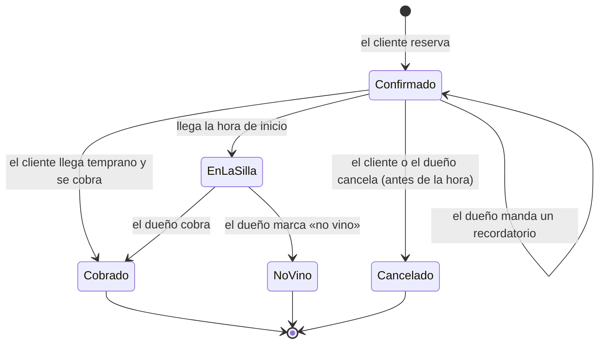

«En la silla» no se guarda como estado aparte: el sistema lo calcula cuando un turno confirmado llegó a su hora.

### Datos de ejemplo

Para que el panel se pueda mostrar sin esperar reservas reales, el sistema genera una agenda de ejemplo para hoy y los próximos días, un historial de turnos de los últimos seis meses (unos 500 clientes, algunos fijos y otros ocasionales, con faltas y cancelaciones), la caja de esos días y algunos movimientos de stock. Los turnos de ejemplo son del primer barbero. Hay dos casos armados para mostrar los clientes repetidos: Rodrigo Villalba, que cambió de número hace tres semanas y reservó con el nuevo, y Thiago Duarte, que reserva con el número de su papá, Óscar Duarte. Los datos se generan a partir de la fecha, así que el mismo día siempre muestra los mismos. Los turnos de ejemplo usan teléfonos `0981 000 …`: en esos, «Recordar» muestra el mensaje en pantalla en vez de abrir WhatsApp. El botón **Reiniciar datos de ejemplo** vuelve todo al principio.

## 7. Funcionalidades

### Sitio para clientes

**Inicio.** Muestra el nombre en graffiti, el logo oficial y el estado del local en tiempo real: «Abierto ahora», a qué hora cierra o cuándo vuelve a abrir. Si el visitante tiene un turno reservado, también aparece «Tenés turno…».

**Precios.** Divide la lista en servicios y combos. Cada uno muestra precio, duración aproximada y un botón «Reservar».


**Cortes.** Una galería con fotos de trabajos del local y el enlace al Instagram.

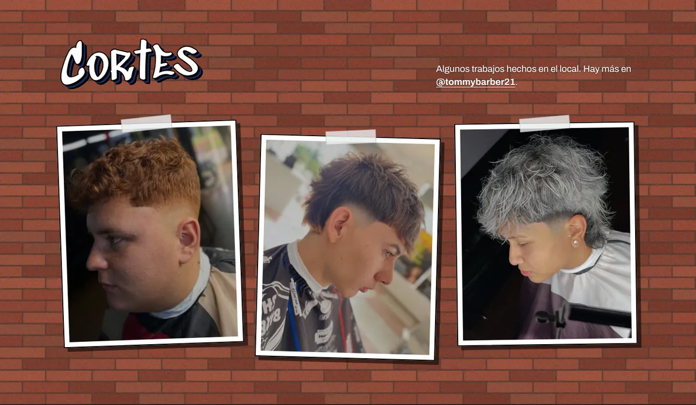

**Reserva en tres pasos.** El cliente elige el servicio, después el día y la hora (solo se muestran los horarios libres), y por último deja sus datos. Al terminar recibe un comprobante con el código del turno.

Cuando trabaja más de un barbero, en el segundo paso aparece **¿Con quién?**: el cliente elige un barbero o «El que esté libre». Con un barbero elegido solo se ven sus días y horas; los días que no viene dicen «no atiende».

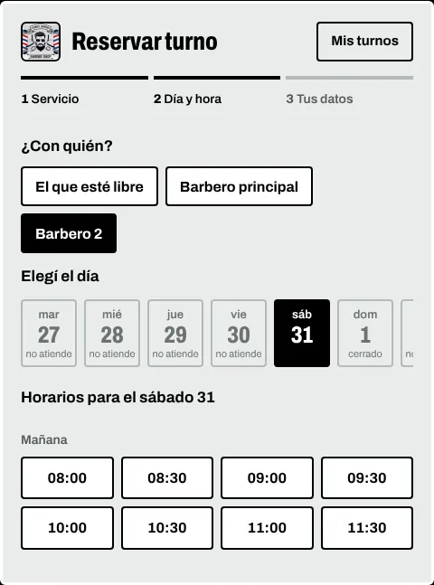

En el último paso, el nombre es el de quien viene a cortarse: un papá puede reservar para su hijo con su propio WhatsApp. Si esa persona ya tiene un turno pendiente, o el número o el celular llegaron al tope, el sitio lo explica y no deja confirmar.

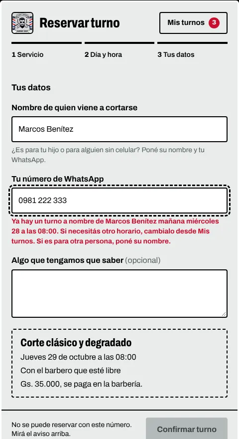


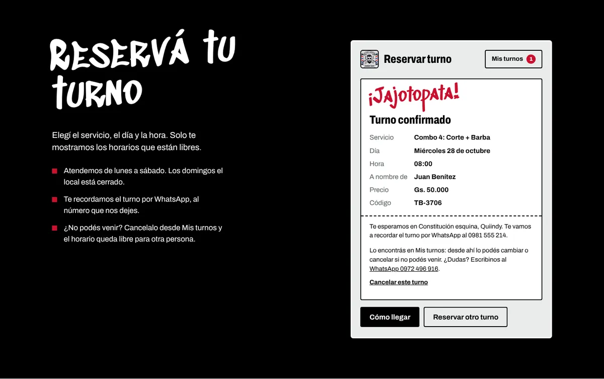

**Mis turnos.** Lista los turnos reservados desde ese celular. Mientras no hayan empezado, el cliente los puede cambiar de día u hora o cancelar, y el horario anterior queda libre para otra persona. Si la barbería canceló un turno, también se ve ahí.

**Cambiar día u hora.** Desde «Mis turnos», el cliente elige un nuevo día y horario sin cancelar y reservar de nuevo; su horario actual aparece marcado. El comprobante dice «Turno cambiado» y cuál era el horario anterior, y en el panel el dueño ve que el cliente lo cambió.

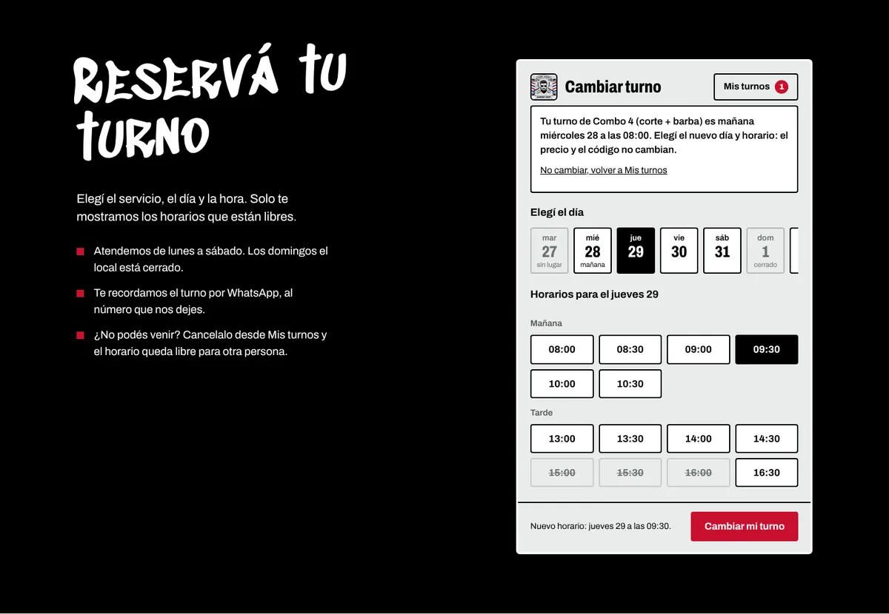

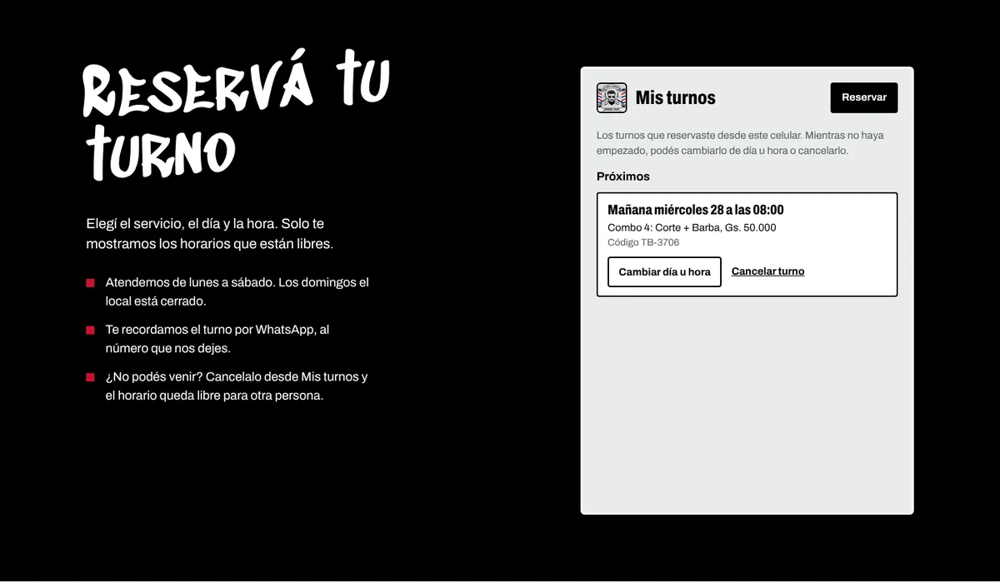

**Horarios y cómo llegar.** Muestran el horario de cada día, con el día de hoy resaltado, y arriba los cambios de las próximas dos semanas (por ejemplo, «Sábado 31 de octubre: cerrado todo el día. Feriado»). Si hay más de un barbero, abajo se ven los días y horas de cada uno. También están la foto de la fachada y los enlaces a Google Maps, WhatsApp (0972 496 916) e Instagram.


### Panel del dueño

Se entra en **/acceso-barberos** (https://tommy-barber.onrender.com/acceso-barberos) con usuario y contraseña. La página de los clientes no tiene botón para entrar. El dueño ve todo el panel; cada barbero ve Atender, Hoy y Turnos, solo con lo suyo. Cualquiera puede cambiar su contraseña con **Cambiar mi contraseña**, abajo del menú.

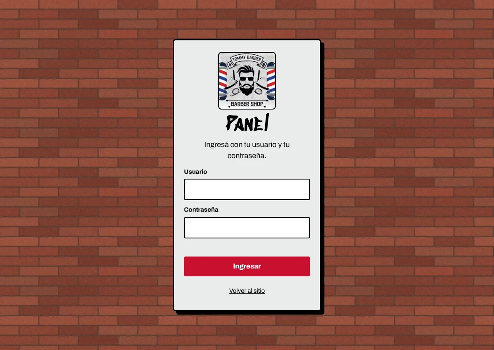

En modo demostración se entra con `#panel` y el PIN de prueba **2121**.

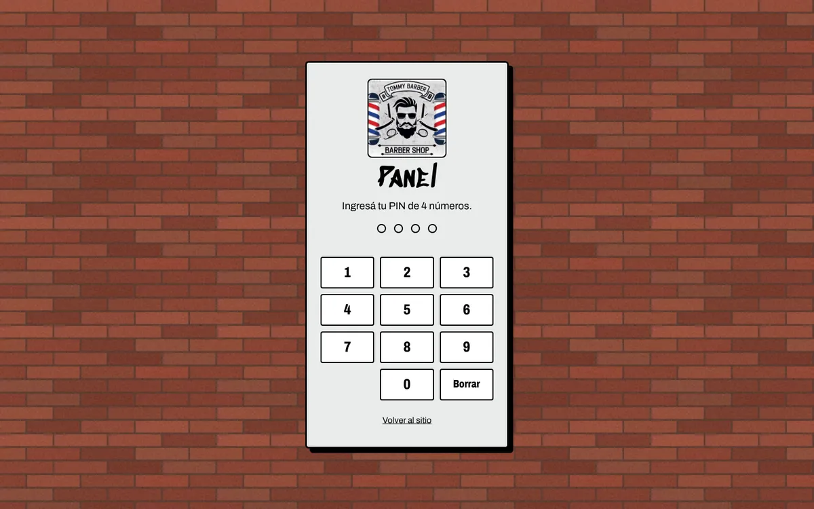

**Atender.** Es la pantalla para usar mientras se corta. Al abrirla ya aparece, en grande, el cliente que corresponde ahora: el primero de la fila del día que todavía no se cobró. Muestra la hora, el nombre, el servicio, cuánto falta o cuánto atraso tiene, y los botones para resolverlo sin buscar nada:

- **Cobrar** con un solo toque, eligiendo el medio de pago: Efectivo, Transferencia o Billetera. El cobro entra solo a la caja.
- **No vino**, cuando ya pasó la hora del turno.
- **Pasar después de…**: si el cliente no llegó y llega el siguiente, se intercambian las horas: el siguiente toma la hora del que no llegó y el que no llegó pasa a la hora del siguiente.
- **¿Venís?**: abre WhatsApp con «te estamos esperando» para el cliente atrasado.
- **Deshacer**, por si tocó algo sin querer.

Si hay más de un barbero, arriba hay **un botón por barbero** con la cantidad de clientes en su fila: cada uno toca su nombre y ve solo sus clientes. Cada celular recuerda qué barbero eligió.

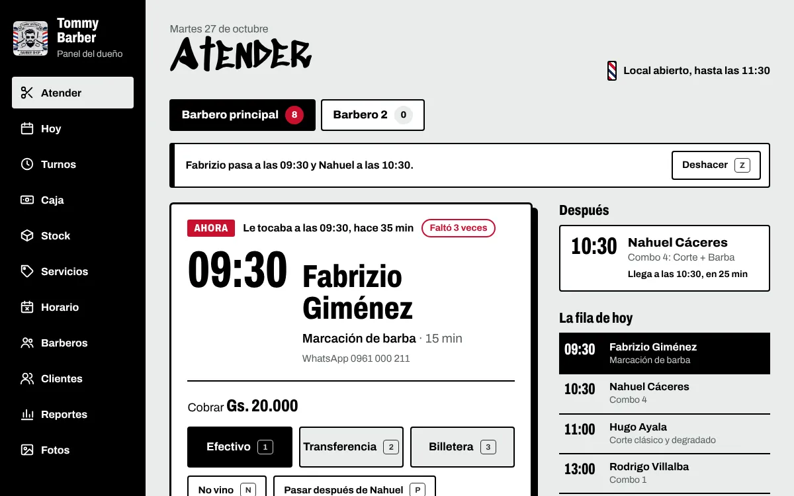

Al lado se ven el siguiente y la fila completa del día. Para alguien que llega sin turno está **Llegó alguien sin turno**:

- Se elige el servicio, con quién (o «el primero que se libere») y, si quiere, su nombre y su WhatsApp.
- El sistema ya elige **la primera hora libre que queda en el día**, no la hora en que llegó. Si esa hora es la que sigue al cliente que se está atendiendo, lo dice («al terminar con Nahuel»). Se puede tocar otra de las horas libres.
- Si hoy ya no hay lugar para ese servicio, muestra las horas libres del próximo día y el botón cambia a «Darle turno el miércoles 28…».

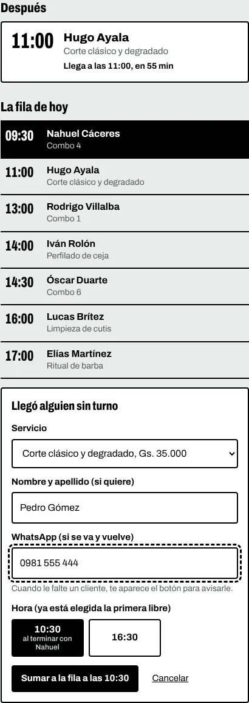

Si el cliente dejó su número y se fue, cuando le falta un cliente aparece **Avisarle por WhatsApp**, con el mensaje ya escrito. Después queda anotado «Le avisaste hoy a las…».

> Hola Pedro, te escribimos de Tommy Barber: ya casi es tu turno. Estamos con el cliente de antes y en unos 25 minutos te toca. Te esperamos en Constitución esquina, Quiindy.

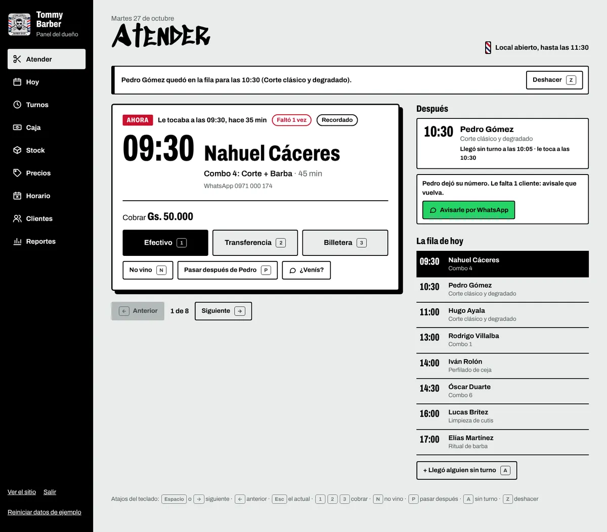

Todo se puede hacer con el teclado, sin el mouse:

| Tecla | Qué hace |
|---|---|
| Espacio o → | Pasa al siguiente de la fila |
| ← | Vuelve al anterior |
| Esc | Vuelve al cliente actual |
| 1, 2, 3 | Cobra en efectivo, por transferencia o con billetera |
| N | No vino |
| P | Lo pasa después del siguiente (intercambia las horas) |
| A | Alguien sin turno |
| Z | Deshace lo último |

Con la dirección `…/#atender` se entra directo a esta pantalla: sirve para dejarla guardada en el celular o la computadora del local.

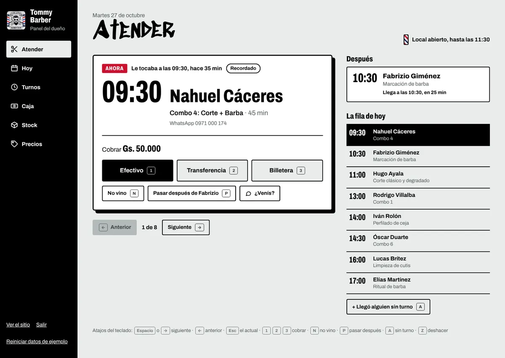

**Hoy.** Agenda completa del día en orden. Cada turno se puede cobrar eligiendo el medio de pago, marcar como «no vino» o cancelar. La pantalla también muestra lo que entró en el día y en la semana, y un aviso si mañana hay turnos sin recordatorio.


**Turnos.** Turnos de los próximos días agrupados por día. «Recordar por WhatsApp» abre WhatsApp con el mensaje listo para el número del cliente, y el dueño solo toca Enviar. Al cancelar, el sistema ofrece avisarle al cliente con otro mensaje preparado. Si el turno es falso, **Es falso: cancelar y bloquear el número** lo cancela sin aviso, bloquea el número y ofrece cancelar los otros turnos pendientes de ese número.

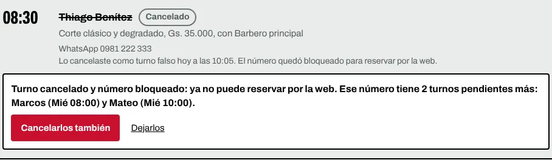

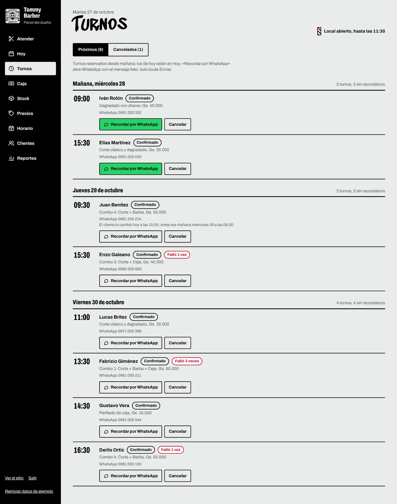

Mensajes que arma el sistema:

> Hola Juan, te recordamos tu turno de Combo 4 (corte + barba) en Tommy Barber: mañana miércoles 28 a las 08:00. Te esperamos en Constitución esquina, Quiindy. Si no podés venir, avisanos por acá. ¡Gracias!

> Hola Juan, te escribimos de Tommy Barber: tuvimos que cancelar tu turno de mañana miércoles 28 a las 08:00. ¿Te queda bien otro horario?

**Caja.** Muestra lo que entró, lo que salió y la ganancia de hoy, la semana o el mes, con el detalle de cada movimiento. Desde acá se anotan gastos y otros ingresos.

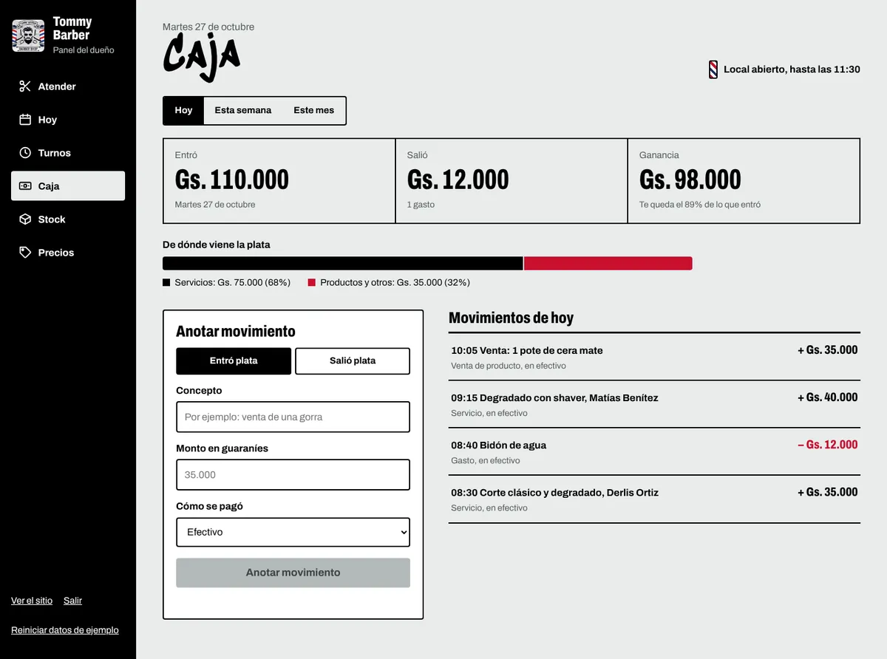

**Stock.** Lista los insumos del local y los productos para vender, con la cantidad disponible y el aviso de reposición. Por cada producto se puede registrar lo que se usó, lo que se vendió (con el medio de pago) y lo que se compró (con el costo), corregir datos o eliminarlo, y también se cargan productos nuevos.


**Servicios.** El dueño cambia el precio y la duración de cada servicio o combo. Las filas cambiadas muestran el valor anterior, y nada se aplica hasta tocar Guardar. El sitio se actualiza enseguida, los cambios quedan en un historial y se puede volver a la lista original del local.

Con **+ Agregar servicio o combo** carga uno nuevo con su nombre, precio y duración (y qué incluye, si es un combo); los que agregó se pueden editar. **Quitar** deja de ofrecer un servicio: ya no aparece en el sitio ni para reservar, pero los turnos reservados siguen y se puede volver a ofrecer.

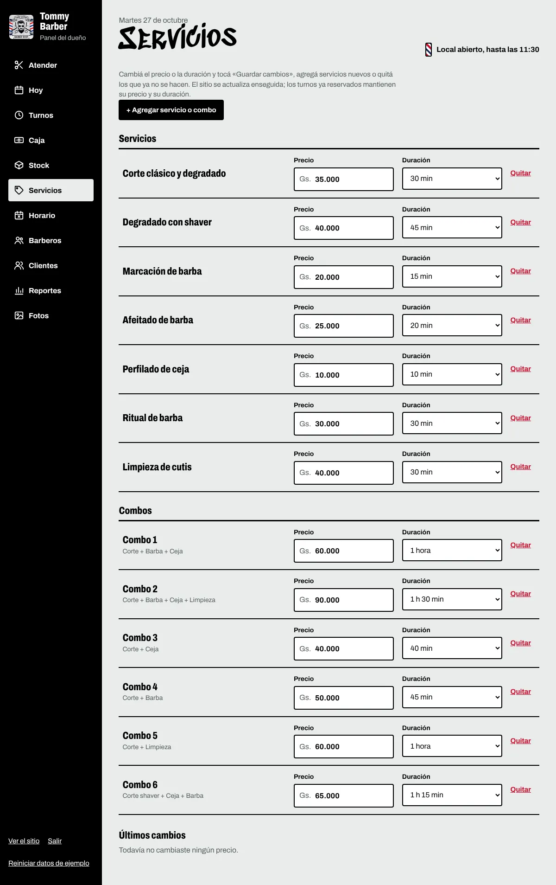

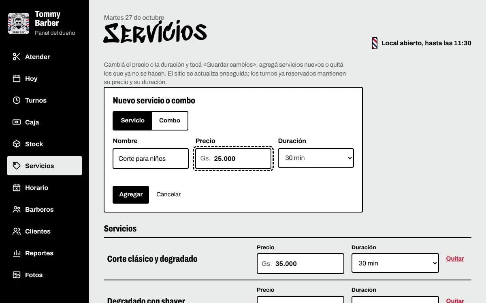

**Horario.** El dueño carga tres tipos de cambio:

- **Cerrar días:** uno o varios días seguidos, por ejemplo un feriado o vacaciones.
- **Cerrar horas:** una franja de un día, por ejemplo de 15:00 a 17:00 por un trámite.
- **Otro horario:** un día que abre distinto, aunque sea domingo.

Con más de un barbero, **¿Para quién?** permite cerrar días u horas solo para uno (vacaciones, un trámite); en el sitio se avisa, por ejemplo, «Barbero 2 no atiende ese día». Antes de guardar, el sistema avisa si hay turnos reservados en ese horario. Después los muestra debajo del cambio para cancelarlos y avisar a cada cliente por WhatsApp. El sitio deja de ofrecer esos horarios enseguida y los avisa en Horarios. Un cambio se puede quitar.

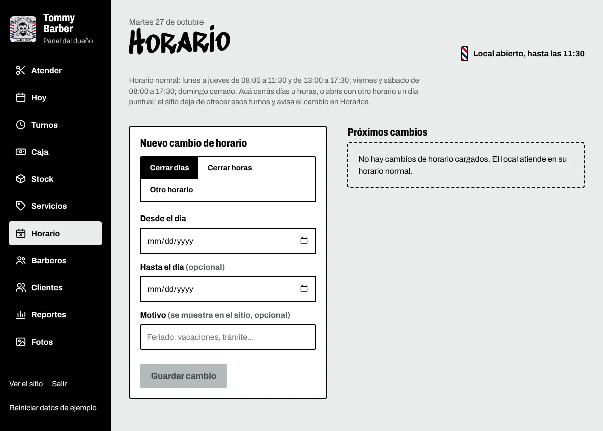

**Barberos.** El dueño agrega barberos con su nombre y los días y horas que atiende, los edita y los quita. Al quitar uno con turnos pendientes, primero se los pasa a otro barbero. El primer barbero se llama «Barbero principal» hasta que el dueño le ponga su nombre.

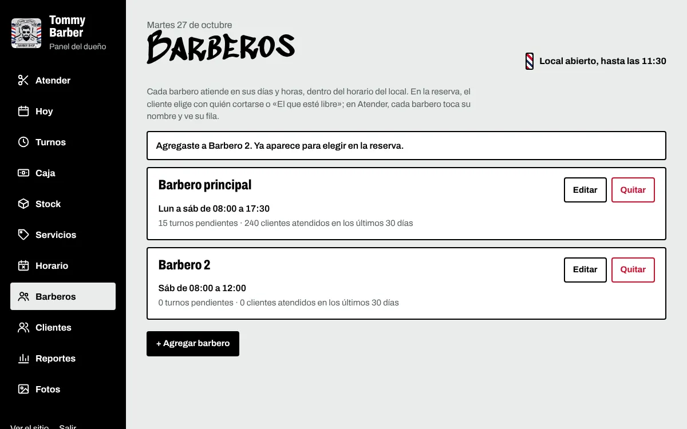

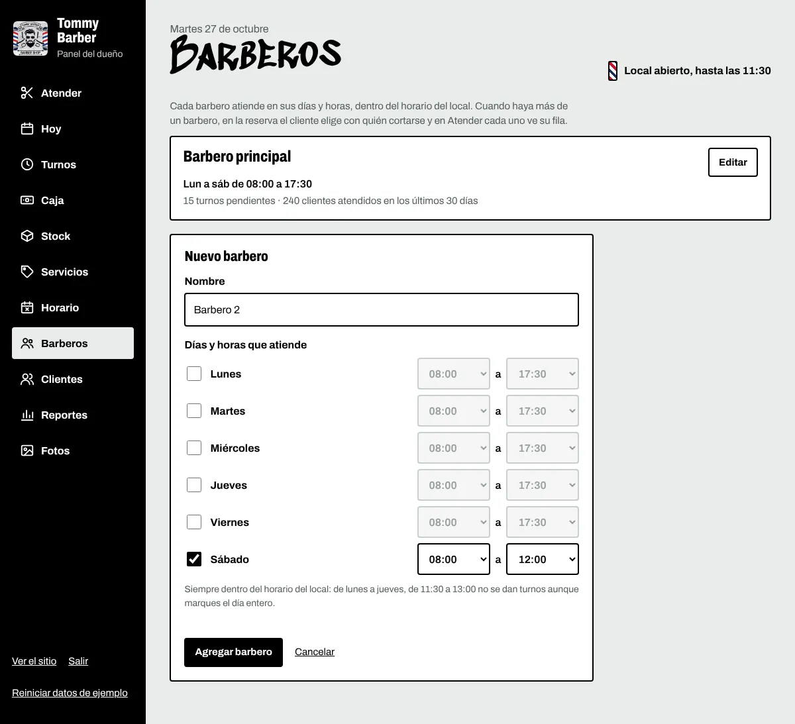

Con la base de datos, en cada barbero está su **acceso al panel**: el dueño le da un usuario y una contraseña («Darle acceso al panel»), le pone una contraseña nueva si se la olvida o le quita el acceso. Al quitar a un barbero, su acceso se cierra solo.

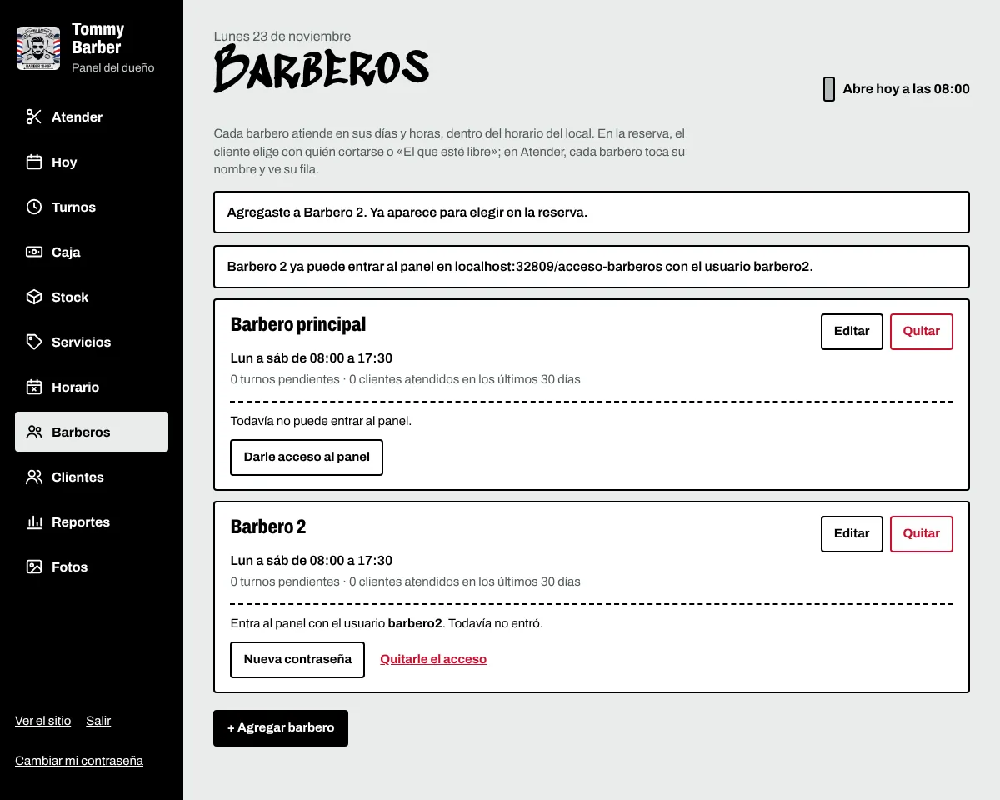

**Clientes.** Cada cliente tiene su número interno (N.º) y se reconoce por su WhatsApp junto con su nombre y apellido. La lista se ordena por los que más vienen, los recientes o los que faltaron, y se busca por nombre, número actual o número anterior. La ficha de cada cliente muestra:

- visitas, cuánto gastó, faltas y cancelaciones;
- desde cuándo es cliente, su último corte, su próximo turno y lo que más se hace;
- el historial de turnos.

Si un cliente faltó antes, Atender, Hoy y Turnos lo marcan con «Faltó 2 veces», para que el dueño decida si le confirma el turno. No se bloquea a nadie.

Para que no haya clientes duplicados:

- **Posibles clientes repetidos:** arriba de la lista aparecen las fichas que pueden ser de la misma persona (mismo nombre con otro número, o mismo número con otro nombre). Se resuelven con **Es el mismo: unir** o **Son distintos**.
- **Cambiar número:** desde la ficha. El número anterior queda guardado y los próximos turnos pasan al nuevo.
- **Unir con otra ficha:** desde la ficha, buscando la otra por nombre, número o N.º. Antes de unir, el sistema dice qué N.º y qué número quedan.

Contra los turnos falsos, la ficha tiene **Bloquear reservas web**, y arriba de la lista se ven los **números bloqueados**, con quiénes los usan, para desbloquearlos.

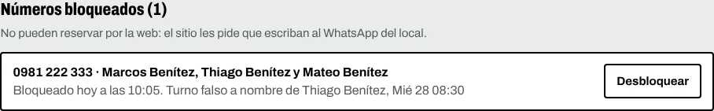

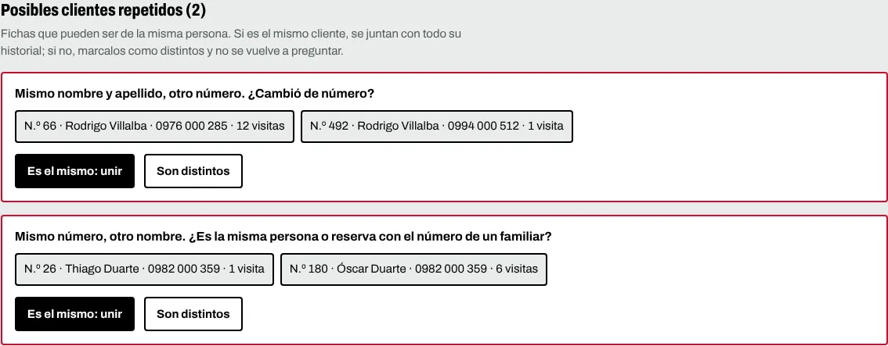

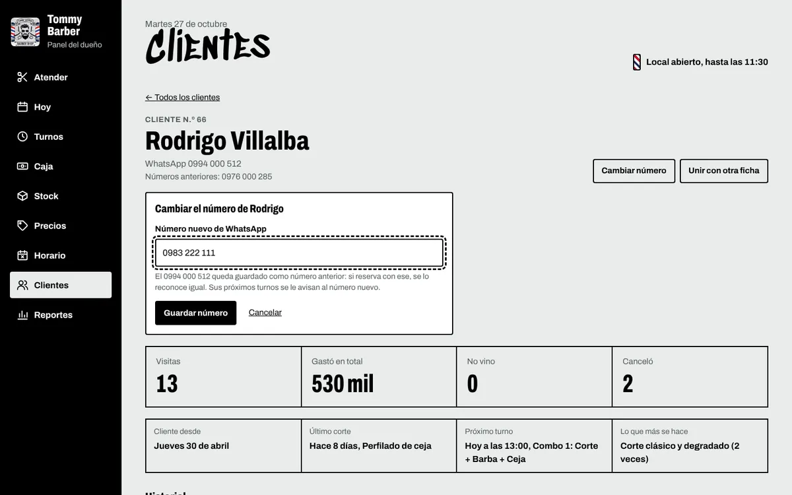


**Reportes.** Para las últimas 4 semanas, 3 meses o 6 meses, muestra tres cosas:

- **Días y horas con más clientes:** un mapa de calor de lunes a sábado, de 08:00 a 18:00, con el día y la hora con más movimiento. Cada casilla es la cantidad de clientes atendidos ese día de la semana en esa hora, sumando todo el período; la leyenda va de «menos clientes» a «más clientes», y el gris es cerrado o sin clientes.
- **Ganancia mes a mes:** lo que entró menos lo que salió de la caja en cada uno de los últimos seis meses.
- **Faltas y cancelaciones:** qué parte de los turnos no vino o se canceló, y los clientes que más faltan.
- **Por barbero** (cuando hay más de uno): clientes atendidos, lo cobrado en servicios y las faltas de cada uno.

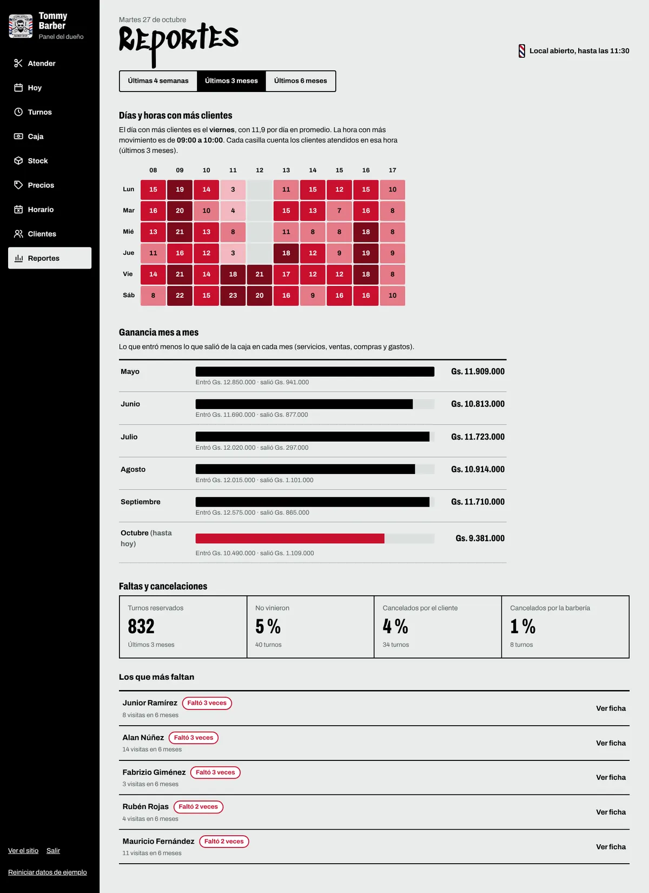

**Fotos.** El dueño cambia el logo, la foto del local y las fotos de cortes. Las fotos se achican solas en el celular antes de guardarse, para que la página siga cargando rápido. En la galería puede agregar fotos (hasta 8), cambiarlas de orden, quitarlas y escribir qué se ve en cada una, que es lo que leen los lectores de pantalla. Siempre se puede volver a las fotos originales.

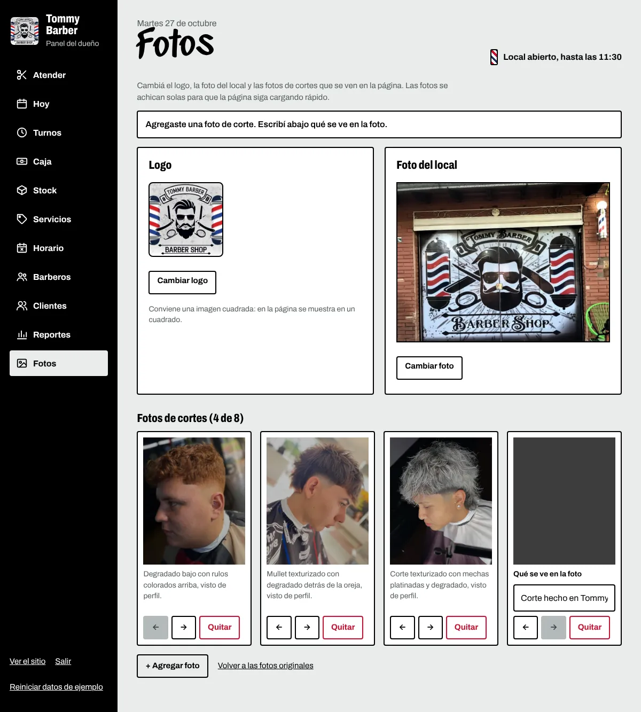

## 8. Velocidad y versión publicada

Lo que se publica no son los archivos originales sino una versión optimizada, que arma `npm run build` (`herramientas/publicar.mjs`):

- El CSS va dentro del HTML, así la página se dibuja sin esperar otro archivo.
- El CSS y el JavaScript van minificados.
- Las imágenes se convierten a AVIF y WebP. Las fotos de la fachada y de la galería salen en varios tamaños para que cada pantalla baje la que necesita, y se cargan recién cuando la página llega a esa parte.
- Las tipografías y el logo se piden apenas llega la página.
- La tipografía Archivo se recortó a los anchos y pesos que usa el sitio: pasó de 88 KB a 58 KB.
- Los archivos llevan un hash en el nombre, así el navegador los guarda un año y baja los nuevos solo cuando cambian.

Medición con Lighthouse en modo celular, con conexión móvil simulada:

| Indicador | Antes | Después |
|---|---|---|
| Puntaje de rendimiento | 92 | 99 |
| Primer contenido visible (FCP) | 1,65 s | 0,97 s |
| Elemento principal visible (LCP) | 3,30 s | 1,95 s |
| Bloqueo del navegador (TBT) | 45 ms | 0 ms |
| Peso total de la página | 413 KB | 171 KB |

## 9. Pruebas

La carpeta `pruebas/` tiene seis recorridos automáticos en modo demostración con Playwright, que abren el sitio en un navegador real con el reloj fijo en el martes 27/10/2026 a las 10:05 (hora de Paraguay). Cada recorrido se hace en computadora y en celular. Además hay una prueba de la base de datos.

- **`probar_todo.py`** (50 comprobaciones por pantalla) prueba:
  - los precios oficiales;
  - una reserva completa y su comprobante;
  - que un teléfono que no es celular no deje confirmar;
  - «Mis turnos», la cancelación por el cliente y que el horario quede libre;
  - el acceso con PIN;
  - cobrar un turno, y cancelar uno con aviso por WhatsApp;
  - los recordatorios y la vista previa de los mensajes de ejemplo;
  - el stock: cargar, usar, vender y comprar, y que no deje usar más de lo que hay;
  - que las ventas y compras del stock lleguen a la caja;
  - que no haya errores en la consola.
- **`probar_atender.py`** prueba la pantalla Atender: la entrada directa con `#atender`, moverse con Espacio y las flechas, cobrar con la tecla 1 y que entre a la caja, deshacer, pasar a alguien después del siguiente, «no vino» solo después de la hora, sumar a alguien sin turno y vaciar la fila.
- **`probar_mejoras.py`** prueba la galería y el WhatsApp del local; el cambio de turno desde «Mis turnos» y que el dueño lo vea; los cambios de horario (cerrar un día con turnos, avisar a los afectados, que el sitio y la reserva lo respeten, cerrar unas horas, abrir un domingo y quitar un cambio); los clientes (lista, búsqueda, ficha y faltas en Atender) y los reportes.
- **`probar_llegada_clientes.py`** prueba la llegada sin turno (que se le dé la primera hora libre y no la hora actual, elegir otra hora, el número mal escrito, el aviso por WhatsApp cuando le falta un cliente y el turno para otro día si hoy no hay lugar) y el registro de clientes (N.º interno, posibles repetidos, «son distintos», unir fichas, buscar por el número anterior, cambiar número y que los cambios sigan después de recargar).
- **`probar_barberos_servicios_fotos.py`** prueba los barberos (agregar uno que viene solo los sábados, nombres repetidos, editar y quitar pasando sus turnos), la reserva con barbero y con «el que esté libre», los topes de turnos (la misma persona, un papá con sus hijos, el celular y el número), Atender por barbero y el intercambio de horas con deshacer, «Es falso: cancelar y bloquear», bloquear y desbloquear números, los servicios nuevos y quitados, un cierre solo para un barbero, el reporte por barbero, las fotos (archivo inválido, logo, foto del local, galería, orden y vuelta a las originales) y que todo entre en la pantalla del celular.
- **`probar_base_de_datos.py`** prueba las reglas de la base de datos con casos reales (ver [BASE_DE_DATOS.md](BASE_DE_DATOS.md#pruebas)).
- **`probar_api.py`** levanta la API y la página con una base de verdad y las recorre como el cliente, el dueño (en dos celulares) y un barbero. Junto con las pruebas de `servidor/pruebas/` está explicado en [API.md](API.md#pruebas).
- **`probar_precios.py`** prueba el cambio de precios desde el panel: la validación, el guardado, el historial, el sitio actualizado, que los turnos reservados conserven su precio y la vuelta a la lista original.

Cómo correrlas:

```
pip install playwright
python -m playwright install chromium
python pruebas/probar_todo.py
python pruebas/probar_precios.py
python pruebas/probar_atender.py
python pruebas/probar_mejoras.py
python pruebas/probar_llegada_clientes.py
python pruebas/probar_barberos_servicios_fotos.py
```

También se pueden correr contra la versión publicada, pasando la dirección como argumento. Las capturas quedan en `pruebas/capturas/`.

## 10. Publicación y base de datos

- El sitio y la API están publicados en **Render**. Cada cambio que se une a `main` en GitHub arma la versión optimizada del sitio y, si cambió el servidor, vuelve a publicar la API.
- La base de datos es **PostgreSQL** y está en **Aiven**. Se diseñó a partir de lo que guarda el sistema: las tablas, las vistas y las reglas del negocio como restricciones. La API le agrega al arrancar lo que necesita (`base-de-datos/03-api.sql`). El diseño completo, el diagrama y cómo se creó están en [BASE_DE_DATOS.md](BASE_DE_DATOS.md).
- La API (`servidor/`) conecta la página y el panel con la base: ver [API.md](API.md).

## 11. Trabajo en equipo

El código está en un repositorio privado de GitHub con los integrantes del grupo como colaboradores. Cada cambio se hace en una rama y entra a `main` por un Pull Request:

| Pull Request | Contenido |
|---|---|
| #1 | Precios oficiales, cancelación de turnos con aviso por WhatsApp, stock del dueño y precios editables desde el panel |
| #2 | Versión optimizada para publicar y configuración de publicación |
| #3 | Esta documentación y las pruebas automáticas |
| #4 | Pantalla Atender |
| #5 | Cambios de horario, clientes, reportes, galería, WhatsApp del local y cambio de turno |
| #6 | Hora libre para el que llega sin turno, aviso por WhatsApp y registro de clientes sin duplicados |
| #7 | Barberos, reserva con barbero, intercambio de horas en Atender, servicios nuevos, fotos editables, protección contra turnos falsos y la base de datos |
| #8 | La API: la página y el panel guardan en la base de datos, panel en `/acceso-barberos` con usuario y contraseña, y acceso de cada barbero a lo suyo |

## 12. Limitaciones y próximos pasos

**Limitaciones**

- Los mensajes de WhatsApp los envía el dueño a mano: el sistema solo abre WhatsApp con el texto listo.
- La API está en un plan gratuito, que se duerme si nadie la usa un rato. Para que no tarde en despertar, un servicio externo la consulta cada 10 minutos (`/api/salud`).
- El panel muestra lo que cambian otros celulares cada 15 segundos (no al instante).
- «Mis turnos» muestra los turnos reservados desde ese celular: si el cliente borra los datos del navegador, los turnos siguen en pie, pero los tiene que cambiar o cancelar escribiendo al WhatsApp del local.

**Próximos pasos**

1. Que el dueño cargue a los barberos y les dé acceso al panel desde **Barberos**.
2. Mandar los recordatorios por WhatsApp solos (hoy los manda el dueño con un toque).
3. Confirmar con el dueño:
   - qué incluye «Barba» en los combos;
   - la calle que cruza con Constitución;
   - los nombres, días y horas de los barberos (el panel ya permite cargarlos);
   - en qué dispositivo va a usar el panel;
   - los productos e insumos que usa y vende;
   - las formas de pago que acepta;
   - el permiso para usar el logo y la foto.
